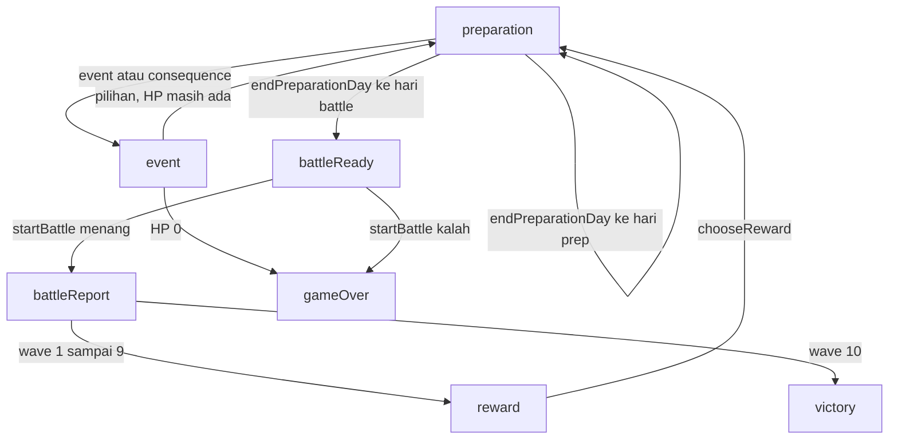

# Alur pengujian dan campaign

## Dari mesin bersih sampai laporan

1. Buka root repository. Dependency sudah terpasang lewat `package-lock.json`. Jangan `npm install` ulang jika `node_modules` ada.
2. Jalankan `npm test` untuk test lama dan suite ini.
3. Jalankan `npm run test:engine` bila hanya ingin folder ini.
4. Jalankan `npm run typecheck`.
5. Baca keluaran Vitest: jumlah pass, fail, skipped, dan durasi.
6. Bandingkan kegagalan dengan [TEST_MATRIX.md](TEST_MATRIX.md) dan [EXPECTED_RESULTS.md](EXPECTED_RESULTS.md).
7. Simulasi menulis `reports/simulation-2026-11-10.json`. Salin angka itu ke laporan. Jangan mengubah expected result agar file hijau.

Test lama tidak dipindah. Mereka ikut `npm test` karena `vitest.config.ts` masih memuat `src/**/*.test.ts`.

## Alur campaign yang diimplementasikan

`createInitialState` masuk hari 1, phase `preparation`, dan langsung menambahkan income hari itu.

Hari persiapan (bukan kelipatan 10) memberi income sekali. Jika `eventPlan` atau consequence jatuh pada hari itu, phase menjadi `event`. Pemain harus `chooseEventOption` sebelum upgrade, repair, atau `endPreparationDay`.

Hari 10, 20, 30, 40, 50, 60, 70, 80, 90, dan 100 menjadi `battleReady`. Tidak ada income dan tidak ada aksi ekonomi. `startBattle` menghitung log sekali.

Wave 1 sampai 9: `continueFromReport` membuka `reward`. Satu id dari tiga pilihan wave itu. State lalu masuk hari berikutnya.

Wave 10: `continueFromReport` membuka `victory`. `rewardsForWave(10)` tidak ada.

HP kota 0 dari battle atau dari efek event membuka `gameOver`. `surrender` juga ke `gameOver`. Fase `gameOver` dan `victory` menolak aksi permainan dengan `GAME_ENDED`.

## Cabang yang dicek

Event: pilihan harus ada di paket tepercaya untuk `runId` dan hari itu. Biaya datang dari paket, lalu dikalikan modifier difficulty satu kali. Narasi hanya boleh mengganti judul, deskripsi, dan label yang tidak menyebut gold, coin, treasury, atau gp.

Consequence: pilihan tertentu menjadwalkan event susulan. Hari trigger stabil untuk `runId` yang sama. Paket susulan hanya sah jika sama dengan paket asal atau ada di depan peta `CONSEQUENCE_SUCCESSOR`. Arah sebaliknya ditolak `isTrustedConsequencePackage`.

Battle: damage kedua pihak memakai HP di awal ronde. Kota kalah jika HP kota 0, termasuk bila monster juga 0. Laporan `cityHpLost` adalah selisih HP, bukan damage yang melewati nol.

Reward: bonus income prep dihapus saat battle dimulai. Bonus defense satu wave dihapus saat wave itu selesai. Dua diskon memakai rate terbesar.

## Save dan load

State disalin dengan `JSON.stringify` lalu `JSON.parse`. Tes memuat kembali state pada phase `event`, `battleReport`, dan `reward`, lalu menjalankan satu aksi yang sah. Battle yang sudah ada di state tidak dihitung lagi.

`endPreparationDay` pada objek hari 1 yang sama dapat dipanggil dua kali dan keduanya berhasil. Engine tidak menyimpan kunci aksi. Backend yang harus menolak `expectedRevision` yang sudah lewat.