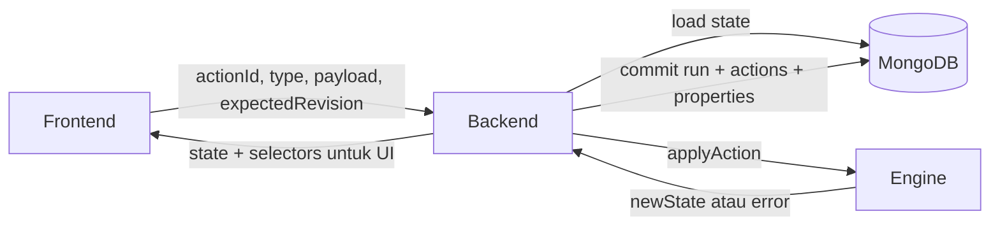

# Fantasy City Defense

Single-player · Next.js · MongoDB · game engine TypeScript murni  
Deadline: **13 November 2026**

**Engine aktif (kode):** campaign **100 hari**, **10 wave**, tiga jalur upgrade (cap **18**), difficulty `easy|normal|hard`, `GameState.version: 4`.  
Referensi lengkap: [`docs/game-engine/README.md`](./docs/game-engine/README.md).  
Kontrak ringkas: [`docs/DEV1_CONTRACT.md`](./docs/DEV1_CONTRACT.md), [`docs/CAMPAIGN_100_DAY_CONTRACT.md`](./docs/CAMPAIGN_100_DAY_CONTRACT.md).

> `MVP.md` / `PRD.md` / bagian persyaratan di `AGENTS.md` masih memuat brief prototipe **20 hari / v3**. Itu adalah kebutuhan/sejarah produk yang belum diselaraskan penuh — bukan sumber aturan engine saat ini. Lihat [`docs/game-engine/DOCUMENTATION_SYNC.md`](./docs/game-engine/DOCUMENTATION_SYNC.md).

## Baca dulu (semua role)

| Dokumen | Isi |
|---|---|
| [docs/game-engine/README.md](./docs/game-engine/README.md) | **Referensi utama** perilaku engine v4 / 100 hari |
| [docs/DEV1_CONTRACT.md](./docs/DEV1_CONTRACT.md) | Kontrak `GameState` v4 / API / error codes |
| [docs/CAMPAIGN_100_DAY_CONTRACT.md](./docs/CAMPAIGN_100_DAY_CONTRACT.md) | Wire FE/BE ke campaign 100 hari |
| [MVP.md](./MVP.md) | Lingkup MVP (masih banyak angka 20-hari — lihat banner di file) |
| [PRD.md](./PRD.md) | Aturan produk (sebagian historis vs engine) |
| [AGENTS.md](./AGENTS.md) | Instruksi agent + persyaratan tertulis (ada konflik dengan kode) |
| [plans/feature-freeze-playtest.md](./plans/feature-freeze-playtest.md) | Freeze fitur + todos FE/BE |
| [plans/game-engine-modules.md](./plans/game-engine-modules.md) | Peta modul (sebagian usang — tautkan ke docs/game-engine) |
| [docs/database/Database_proposal.md](./docs/database/Database_proposal.md) | Schema MongoDB & makna field |
| [docs/database/FLOW_DATABASE.md](./docs/database/FLOW_DATABASE.md) | Alur Mulai / Aksi / Event / Battle / Auth |

### Keputusan yang masih berlaku di engine

- **Tidak ada rekrutmen unit** (tidak ada HP pasukan individual / formasi).
- **Tiga jalur upgrade:** tembok (DEF), pasukan (ATK kota), kota (MaxHP + income) — state `version: 4`.
- Satu slot aksi harian: salah satu dari tiga upgrade **atau** repair.
- Diskon = **diskon upgrade** ke ketiga jalur, bukan diskon rekrut; repair tidak didiskon.
- Playtest terkunci di kode: `dailyIncome` **28**; biaya `45 + level × 30`; max level **18**; repair **25/60**; wall **+3 DEF**; city **+35 MaxHP** / income **+5**.
- Fase battle: `battleReady` → `battleReport` (bukan `battle`).
- Persistensi produk = **MongoDB + auth**, bukan hanya localStorage.
- Campaign di engine = **100 hari / 10 wave** (bukan 20 atau 50).
- Engine siap diintegrasikan; cek gap adapter di kontrak FE/BE dan `app/docs/`.

---

## Siapa mengerjakan apa



### Engine (Developer 1) — status: siap integrasi (v4)

**Sudah ada**

- Modul murni di `src/game/` (kalender 100 hari, ekonomi 3 jalur, eventPlan + consequence, battle, reward per wave, difficulty, transisi).
- `GameState` `version: 4` (`wallLevel`, `troopLevel`, `cityLevel`, `difficulty`, `eventPlan`, `pendingConsequences`, `rewardsChosenByWave`); `revision` naik pada aksi sukses.
- API publik: create, upgrade ×3, repair, end day, event, battle, reward, surrender + selectors.
- Unit/integration test di `src/game` dan `tests/game-engine` (alur 100 hari).
- Try UI: `npm run play`. Catatan harness lama: [docs/HARNESS.md](./docs/HARNESS.md) (sebagian script/contoh masih era 20-hari).

**Sekarang**

- Bugfix kontrak saja; jangan sistem baru sampai playtest (lihat feature freeze).

**Jangan**

- React produk, Mongo driver, auth, API key AI, timer di dalam engine.

### Backend — lanjutkan

**Kerjakan (urutan disarankan)**

1. Auth: register/login username + passwordHash; sesi; `User.saveGame` / `gameHistory`.
2. Mulai permainan baru: `createInitialState({ runId, difficulty })` → commit `game_runs` + properties awal + `runs_event` sesuai `eventPlan` (bukan empat hari tetap).
3. Lanjutkan save: baca `game_runs.state` + properties revisi yang sama; tolak `version` ≠ **4** dengan jelas.
4. Endpoint submit aksi: `runId`, `actionId`, `expectedRevision`, `type`, `payload` → load state → panggil engine → transaksi commit.
5. Types aksi minimal: `upgradeWall` | `upgradeTroops` | `upgradeCity` | `repairCity` | `endPreparationDay` | `chooseEventOption` | `startBattle` | `continueFromReport` | `chooseReward` | `attachActiveEvent` | `surrender`.
6. Persist: `game_runs.state` v4 (termasuk `difficulty`, `eventPlan`, `pendingConsequences`, `rewardsChosenByWave`), `game_actions`, `game_properties` dari **selector engine**, update save pointer.
7. Event: AI/mock hanya narasi; validasi `packageId`/hari dari plan; fallback; jangan ganti event aktif setelah fallback; dukung consequence.
8. Battle: panggil engine sekali; simpan `game_report`; refresh baca hasil, tidak re-resolve.
9. Tolak `DUPLICATE_ACTION` / revisi stale; jangan hitung biaya/damage di luar engine.

**Jangan**

- Menyalin rumus damage/biaya/transisi di luar pemanggilan engine.
- Mengasumsikan field `upgradeLevel` tunggal atau `rewardChosenId` (sudah diganti jalur tiga + `rewardsChosenByWave`).
- Mengasumsikan FE/BE sudah lengkap hanya karena dokumen integrasi ada — verifikasi runtime.

Acuan schema: [docs/database/schema_new.completed.drawio](./docs/database/schema_new.completed.drawio).

### Frontend — lanjutkan

**Kerjakan (urutan disarankan)**

1. Auth UI + new game / continue (wire ke API BE).
2. Dashboard fase: hari, fase, gold, HP/MaxHP, **tiga level**, ATK/DEF/income, aksi tersisa, ancaman, efek + expiry.
3. Panel aksi: tiga upgrade + repair + lanjut hari; preview biaya dari API/selector.
4. Alur event (2–4 pilihan + consequence), battle playback dari log tersimpan, laporan, reward per wave 1–9, layar menang/kalah.
5. Error code dari server (`INSUFFICIENT_GOLD`, `EVENT_REQUIRED`, `STALE_REVISION`, dll.) tanpa spekulasi state lokal.
6. Double-submit: `actionId` unik per klik; setelah sukses pakai state server terbaru.
7. Mode Auto lanjut hari (timer 5s di UI saja; tidak auto-beli) — [plans/auto-run-20-dan-50.md](./plans/auto-run-20-dan-50.md).

**Jangan**

- Implementasi aturan ekonomi/battle kedua di UI.
- Menyimpan save produk hanya di localStorage sebagai sumber kebenaran (try UI / harness debug boleh terpisah).

---

## Todos minggu ini (Frontend & Backend)

Sinkron dengan [plans/feature-freeze-playtest.md](./plans/feature-freeze-playtest.md).

### Backend

- [ ] Auth register/login + sesi
- [ ] `POST` mulai game: engine `createInitialState` + commit Mongo + pilih/isi event katalog
- [ ] `GET` lanjutkan / baca state + laporan + event aktif
- [ ] `POST` aksi gameplay dengan `actionId` + `expectedRevision` (upgrade ×3, repair, end day)
- [ ] Wire event choice, start battle, continue report, choose reward
- [ ] Fallback narasi event jika AI/mock gagal
- [ ] Tolak save `version` lama / data inkonsisten dengan pesan jelas

### Frontend

- [ ] Halaman auth + new / continue
- [ ] Dashboard + tiga tombol upgrade + repair + lanjut hari (dari state API)
- [ ] UI event, battle report playback, reward, victory/game over
- [ ] Tangani error code + cegah double-submit
- [ ] Auto Manual/Auto (countdown 5s, jeda di event/battle/reward)
- [ ] Smoke alur hari 1–20 bersama BE

### Bersama

- [ ] Happy path E2E: new game → hari 10 → reward → hari 20 → victory/defeat
- [ ] Playtest eksternal 1 orang + catat 3–5 keluhan
- [ ] Baru setelah playtest: max 1 fitur dari keluhan nyata

---

## Setup

```bash
npm install
npm run typecheck
npm test
```

UI uji engine (bukan UI produk; state di `localStorage` key `fantasy-try-ui-v1`):

```bash
npm run play
```

Buka http://127.0.0.1:5173/ . Tombol hanya memanggil API `src/game`.

Harness mock narasi (jika diaktifkan): lihat [docs/HARNESS.md](./docs/HARNESS.md).

---

## Integrasi harian (disarankan)

1. Backend wire satu aksi (mis. `upgradeTroops`) end-to-end ke Mongo.
2. Frontend wire tombol yang sama ke API; jangan menunggu seluruh surface selesai.
3. Lanjut event → battle → reward dengan kontrak error code yang sama.
4. Engine hanya diubah jika bug kontrak; angka balancing lewat config bersama.

## Status dokumen

| File | Status |
|---|---|
| MVP / PRD v2.1 | Acuan produk tertulis (sebagian 20-hari); engine aktif lihat docs/game-engine |
| AGENTS + DEV1_CONTRACT | Acuan engine v3 |
| plans/feature-freeze-playtest | Todos FE/BE + freeze |
| plans/ | Diskusi modul & roadmap |
| docs/database/ | Acuan persistensi (implementasi BE) |
