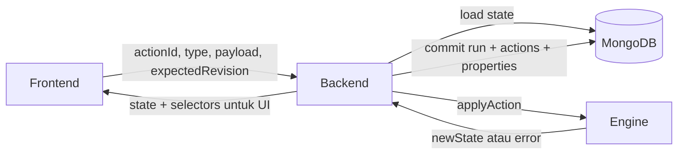

# Fantasy City Defense

Prototipe single-player 20 hari · Next.js · MongoDB · game engine TypeScript murni  
Deadline: **13 November 2026**

## Baca dulu (semua role)

| Dokumen | Isi |
|---|---|
| [MVP.md](./MVP.md) | Lingkup wajib & kriteria selesai |
| [PRD.md](./PRD.md) | Aturan produk (fase, ekonomi, battle, event, reward) |
| [AGENTS.md](./AGENTS.md) | Spek detail mesin untuk Developer Engine |
| [docs/DEV1_CONTRACT.md](./docs/DEV1_CONTRACT.md) | Kontrak `GameState` v3 / API / error codes |
| [plans/feature-freeze-playtest.md](./plans/feature-freeze-playtest.md) | Freeze fitur + todos FE/BE minggu ini |
| [plans/game-engine-modules.md](./plans/game-engine-modules.md) | Daftar modul engine + batas tanggung jawab |
| [docs/database/Database_proposal.md](./docs/database/Database_proposal.md) | Schema MongoDB & makna field |
| [docs/database/FLOW_DATABASE.md](./docs/database/FLOW_DATABASE.md) | Alur Mulai / Aksi / Event / Battle / Auth |

### Keputusan yang menggantikan dokumen lama

- **Tidak ada rekrutmen unit** (tidak ada HP pasukan individual / formasi).
- **Tiga jalur upgrade:** tembok (DEF), pasukan (ATK kota), kota (MaxHP + income) — state `version: 3`.
- Satu slot aksi harian: salah satu dari tiga upgrade **atau** repair.
- Diskon = **diskon upgrade** ke ketiga jalur, bukan diskon rekrut.
- Playtest: `dailyIncome` **25**; bonus income kota **+8** / level.
- Fase battle: `battleReady` → `battleReport` (bukan `battle`).
- Persistensi produk = **MongoDB + auth**, bukan hanya localStorage.
- Prototipe = **20 hari**; setelah playtest oke → produksi **50 hari** ([PRD.md](./PRD.md) §12).
- Engine prototipe siap integrasi; **lanjutan utama = Backend + Frontend**.

---

## Siapa mengerjakan apa



### Engine (Developer 1) — status: siap integrasi

**Sudah ada**

- Modul murni di `src/game/` (kalender, ekonomi 3 jalur, event, battle, reward, transisi).
- `GameState` `version: 3` (`wallLevel`, `troopLevel`, `cityLevel`); `revision` naik hanya jika state berubah.
- API publik: create, `upgradeWall` / `upgradeTroops` / `upgradeCity`, repair, end day, event, battle, reward + selectors.
- Unit test + integration test alur 20 hari.
- Opsional harness: [docs/HARNESS.md](./docs/HARNESS.md). Try UI: `npm run play`.

**Sekarang**

- Bugfix kontrak saja; jangan sistem baru sampai playtest (lihat feature freeze).

**Jangan**

- React produk, Mongo driver, auth, API key AI, timer di dalam engine.

### Backend — lanjutkan

**Kerjakan (urutan disarankan)**

1. Auth: register/login username + passwordHash; sesi; `User.saveGame` / `gameHistory`.
2. Mulai permainan baru: `createInitialState` → commit `game_runs` + properties awal + empat `runs_event` (katalog `event_data` / AI narasi / fallback).
3. Lanjutkan save: baca `game_runs.state` + properties revisi yang sama; tolak `version` ≠ 3 dengan jelas.
4. Endpoint submit aksi: `runId`, `actionId`, `expectedRevision`, `type`, `payload` → load state → panggil engine → transaksi commit.
5. Types aksi minimal: `upgradeWall` | `upgradeTroops` | `upgradeCity` | `repairCity` | `endPreparationDay` | `chooseEventOption` | `startBattle` | `continueFromReport` | `chooseReward` | `attachActiveEvent`.
6. Persist: `game_runs.state`, `game_actions`, `game_properties` (gold, cityHp, cityMaxHp, wallLevel, troopLevel, cityLevel, attack, defense dari **selector engine**), update save pointer.
7. Event: AI/mock hanya narasi; validasi `packageId`/hari; fallback; jangan ganti event aktif setelah fallback.
8. Battle: panggil engine sekali; simpan `game_report`; refresh baca hasil, tidak re-resolve.
9. Tolak `DUPLICATE_ACTION` / revisi stale; jangan hitung biaya/damage di luar engine.

**Jangan**

- Menyalin rumus damage/biaya/transisi di luar pemanggilan engine.
- Mengasumsikan field `upgradeLevel` tunggal (sudah diganti v3).

Acuan schema: [docs/database/schema_new.completed.drawio](./docs/database/schema_new.completed.drawio).

### Frontend — lanjutkan

**Kerjakan (urutan disarankan)**

1. Auth UI + new game / continue (wire ke API BE).
2. Dashboard fase: hari, fase, gold, HP/MaxHP, **tiga level**, ATK/DEF/income, aksi tersisa, ancaman, efek + expiry.
3. Panel aksi: tiga upgrade + repair + lanjut hari; preview biaya dari API/selector.
4. Alur event (dua pilihan), battle playback dari log tersimpan, laporan, reward, layar menang/kalah.
5. Error code dari server (`INSUFFICIENT_GOLD`, `EVENT_REQUIRED`, `STALE_REVISION`, dll.) tanpa spekulasi state lokal.
6. Double-submit: `actionId` unik per klik; setelah sukses pakai state server terbaru.
7. Mode Auto lanjut hari (timer 5s di UI saja; tidak auto-beli) — [plans/auto-run-20-dan-50.md](./plans/auto-run-20-dan-50.md).

**Jangan**

- Implementasi aturan ekonomi/battle kedua di UI.
- Menyimpan save produk hanya di localStorage sebagai sumber kebenaran (try UI / harness debug boleh terpisah).

---

## Todos minggu ini (Frontend & Backend)

Sinkron dengan [plans/feature-freeze-playtest.md](./plans/feature-freeze-playtest.md).

### Backend

- [ ] Auth register/login + sesi
- [ ] `POST` mulai game: engine `createInitialState` + commit Mongo + pilih/isi event katalog
- [ ] `GET` lanjutkan / baca state + laporan + event aktif
- [ ] `POST` aksi gameplay dengan `actionId` + `expectedRevision` (upgrade ×3, repair, end day)
- [ ] Wire event choice, start battle, continue report, choose reward
- [ ] Fallback narasi event jika AI/mock gagal
- [ ] Tolak save `version` lama / data inkonsisten dengan pesan jelas

### Frontend

- [ ] Halaman auth + new / continue
- [ ] Dashboard + tiga tombol upgrade + repair + lanjut hari (dari state API)
- [ ] UI event, battle report playback, reward, victory/game over
- [ ] Tangani error code + cegah double-submit
- [ ] Auto Manual/Auto (countdown 5s, jeda di event/battle/reward)
- [ ] Smoke alur hari 1–20 bersama BE

### Bersama

- [ ] Happy path E2E: new game → hari 10 → reward → hari 20 → victory/defeat
- [ ] Playtest eksternal 1 orang + catat 3–5 keluhan
- [ ] Baru setelah playtest: max 1 fitur dari keluhan nyata

---

## Setup

```bash
npm install
npm run typecheck
npm test
```

UI uji engine (bukan UI produk; state di `localStorage` key `fantasy-try-ui-v1`):

```bash
npm run play
```

Buka http://127.0.0.1:5173/ . Tombol hanya memanggil API `src/game`.

Harness mock narasi (jika diaktifkan): lihat [docs/HARNESS.md](./docs/HARNESS.md).

---

## Integrasi harian (disarankan)

1. Backend wire satu aksi (mis. `upgradeTroops`) end-to-end ke Mongo.
2. Frontend wire tombol yang sama ke API; jangan menunggu seluruh surface selesai.
3. Lanjut event → battle → reward dengan kontrak error code yang sama.
4. Engine hanya diubah jika bug kontrak; angka balancing lewat config bersama.

## Status dokumen

| File | Status |
|---|---|
| MVP / PRD v2.1 | Acuan produk: tiga jalur upgrade, income 25 |
| AGENTS + DEV1_CONTRACT | Acuan engine v3 |
| plans/feature-freeze-playtest | Todos FE/BE + freeze |
| plans/ | Diskusi modul & roadmap |
| docs/database/ | Acuan persistensi (implementasi BE) |
