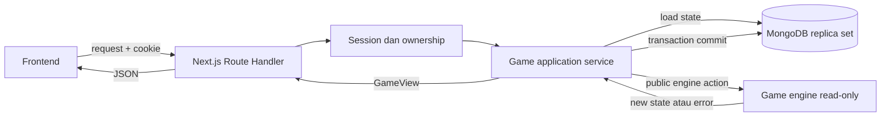

# Backend Implementation Plan — Fantasy City Defense

Status: **Planning**  
Target: prototipe 20 hari / 2 wave  
Backend: Next.js Route Handlers + MongoDB  
Kontrak engine: `../../docs/DEV1_CONTRACT.md` dan `../../src/game` (read-only)

## 0. Keputusan yang sudah dikunci

Keputusan berikut telah dikonfirmasi oleh pemilik backend dan menjadi default implementasi:

| Area | Keputusan |
|---|---|
| Database | MongoDB Atlas, dikelola oleh developer backend |
| Deployment | Vercel |
| Session | JWT `HS256` dalam cookie `HttpOnly`; session aktif diverifikasi melalui `jti` di MongoDB |
| Durasi session | Tetap 7 hari sejak login; tidak sliding pada setiap request |
| Perangkat | Satu user hanya memiliki satu session aktif; login sukses baru mencabut session lama |
| Logout | Session server dan cookie dihapus; user harus login lagi untuk melanjutkan save terakhir |
| Password | Minimum 6 karakter; disimpan sebagai password hash bcrypt |
| Kontrak API | Dimiliki backend; frontend mengikuti kontrak di `contracts/**` |
| Integrasi engine | Engine root read-only; backend memakai public API melalui satu adapter |
| Ruleset MVP | Config engine tetap sumber aturan; MongoDB menyimpan identitas/metadata ruleset |
| Event AI | OpenAI Responses API wajib tersedia saat demo, dengan timeout dan fallback terpercaya |
| Model AI | Model dikonfigurasi melalui `OPENAI_MODEL`; model harus mendukung Structured Outputs |
| Credential AI | `OPENAI_API_KEY` server-only; dapat diganti per developer melalui environment |
| Runtime validation | Zod untuk request API, environment, state boundary, dan output AI |
| Database schema | Mengikuti state versi 3 dan delapan game properties |
| Identitas MongoDB | `_id` dan referensi dokumen memakai `ObjectId` |
| Save aktif | Satu save aktif; run lama tetap tersimpan ketika pointer diganti dan tidak otomatis dianggap selesai |
| File ownership | Mengikuti pembagian backend/frontend/shared pada dokumen ini |

Beberapa detail teknis masih harus ditentukan sebelum Phase 1: model OpenAI default, hasil benchmark cost bcrypt pada Vercel, dan hasil technical spike import engine.

## 1. Tujuan dokumen

Dokumen ini menjadi rencana kerja backend dan batas integrasi antara tiga bagian aplikasi:

1. **Game engine** menentukan seluruh aturan permainan dan menghasilkan `GameState` baru.
2. **Backend** menangani autentikasi, ownership, validasi input, persistensi, konkurensi, event narrative, dan API.
3. **Frontend** menampilkan state dari server dan mengirim command pemain melalui API.

Dokumen ini bukan implementasi. Perubahan kode dimulai setelah kontrak request/response, strategi session, dan deployment MongoDB disepakati.

## 2. Batas scope dan kepemilikan file

### Backend boleh mengubah

- `app/api/**` untuk Route Handlers.
- `server/**` untuk kode server, database, autentikasi, repository, dan integrasi engine.
- `contracts/**` untuk tipe request/response yang dikonsumsi frontend.
- `.env.example` untuk daftar environment variable tanpa secret.
- Test backend yang berada di dalam package `app`.

Semua path di atas relatif terhadap folder `app/` tempat dokumen ini berada.

### Backend tidak boleh mengubah

- `../../src/**` — game engine milik Developer Engine.
- `../../docs/**` — kontrak/dokumentasi root milik bersama.
- `components/**`, halaman frontend, styling, dan aset frontend kecuali ada persetujuan eksplisit.
- File dokumentasi untracked milik developer lain.

### File bersama yang harus dikoordinasikan

- `package.json` dan `package-lock.json`.
- `tsconfig.json`.
- `next.config.ts`.
- `app/layout.tsx` bila suatu saat auth memerlukan provider di UI.

Backend melakukan staging dengan path spesifik dan tidak menggunakan `git add .`, agar file frontend atau dokumen untracked tidak ikut masuk commit.

## 3. Sumber kebenaran

Urutan sumber kebenaran ketika ada perbedaan:

1. Kontrak engine committed di `../../docs/DEV1_CONTRACT.md`.
2. Public API dan tipe aktual di `../../src/game`.
3. Kontrak API backend di `contracts/**`.
4. Schema persistensi backend.
5. Tampilan frontend.

Konsekuensinya:

- Backend tidak menghitung harga, income, damage, bonus, atau transisi fase sendiri.
- Frontend tidak mengirim nilai akhir gold/HP/level yang dipercaya server.
- Backend tidak melakukan migrasi diam-diam dari state versi lama.
- `GameState.version` yang diterima untuk MVP adalah `3`.

### Dokumen turunan backend

Rencana ini dijabarkan menjadi dokumen kerja berikut:

- [API_CONTRACT.md](./API_CONTRACT.md) — endpoint, request/response, error, idempotency, dan kewajiban frontend.
- [DATABASE_SCHEMA_V3.md](./DATABASE_SCHEMA_V3.md) — collection, document shape, index, transaksi, dan strategi ID.
- [AI_EVENT_RUNTIME.md](./AI_EVENT_RUNTIME.md) — OpenAI Responses API, Structured Outputs Zod, timeout, dan fallback.
- [AUTH_SESSION_SPEC.md](./AUTH_SESSION_SPEC.md) — bcrypt, JWT cookie, single session berbasis `jti`, CSRF, dan rate limit.
- [TEST_PLAN.md](./TEST_PLAN.md) — matrix unit, integration, contract, concurrency, security, dan smoke test.
- [ENVIRONMENT_AND_DEPLOYMENT.md](./ENVIRONMENT_AND_DEPLOYMENT.md) — MongoDB Atlas, Vercel, environment, release, dan rollback.
- [BACKEND_ACTION_LOG.md](./BACKEND_ACTION_LOG.md) — catatan kronologis seluruh tindakan material backend.

## 4. Gambaran arsitektur



Route Handler dibuat tipis. Aturan aplikasi berada di `server/**`, sedangkan aturan game tetap di engine.

## 5. Struktur folder target

```text
app/
├── app/
│   └── api/
│       ├── health/route.ts
│       ├── auth/
│       │   ├── register/route.ts
│       │   ├── login/route.ts
│       │   ├── logout/route.ts
│       │   └── me/route.ts
│       └── runs/
│           ├── route.ts
│           ├── current/route.ts
│           └── [runId]/
│               ├── route.ts
│               └── actions/route.ts
├── contracts/
│   ├── api.ts
│   ├── auth.ts
│   └── game-actions.ts
├── server/
│   ├── auth/
│   │   ├── password.ts
│   │   ├── session.ts
│   │   └── require-user.ts
│   ├── db/
│   │   ├── client.ts
│   │   ├── collections.ts
│   │   └── indexes.ts
│   ├── game/
│   │   ├── engine-adapter.ts
│   │   ├── action-dispatcher.ts
│   │   ├── game-view.ts
│   │   └── event-narrative.ts
│   ├── repositories/
│   ├── services/
│   ├── validation/
│   └── http/
└── tests/
    ├── unit/
    ├── integration/
    └── postman/
```

Nama dapat disesuaikan saat implementasi, tetapi pemisahan tanggung jawabnya dipertahankan.

## 6. Technical spike pertama: Next.js ke engine

Sebelum database dan auth dibuat, backend harus membuktikan bahwa package Next.js di `app/` dapat memakai engine root tanpa menyalin source.

Langkah:

1. Buat `server/game/engine-adapter.ts`.
2. Import hanya public API dari `../../src/game` melalui path yang disepakati.
3. Panggil `createInitialState` dan `getEffectiveStats` dari server-only code.
4. Buat route sementara atau test yang memverifikasi hasil JSON.
5. Jalankan typecheck dan build Next.js.

Kriteria selesai:

- Engine dapat di-import tanpa perubahan pada root `src/`.
- Tidak ada salinan rumus atau tipe engine di backend.
- Engine tidak ikut dikirim ke client bundle.
- Typecheck dan build berhasil.

Jika membutuhkan perubahan `next.config.ts` atau `tsconfig.json`, perubahan itu harus diberitahukan kepada frontend karena kedua file bersifat shared.

## 7. Kontrak API untuk frontend

### 7.1 Format respons sukses

```ts
type ApiSuccess<T> = {
  ok: true;
  data: T;
};
```

### 7.2 Format respons gagal

```ts
type ApiFailure = {
  ok: false;
  error: {
    code: string;
    message: string;
    fields?: Record<string, string>;
  };
};
```

Frontend memakai `error.code` untuk perilaku UI. `message` digunakan untuk pesan aman kepada pengguna dan tidak memuat stack trace atau detail database.

### 7.3 Game view

Frontend menerima satu representasi server yang konsisten:

```ts
type GameView = {
  state: GameState;
  stats: EffectiveStats;
  wavePreview: ReturnType<typeof getWavePreview>;
  eventNarrative: EventNarrativeView | null;
  report: BattleReportView | null;
};
```

`stats` dan `wavePreview` berasal dari selector engine. Frontend tidak menghitung ulang biaya atau stat efektif.

### 7.4 Endpoint MVP

| Method | Endpoint | Fungsi |
|---|---|---|
| `GET` | `/api/health` | Status aplikasi dan koneksi database |
| `POST` | `/api/auth/register` | Membuat user baru |
| `POST` | `/api/auth/login` | Memverifikasi kredensial dan membuat session |
| `POST` | `/api/auth/logout` | Mengakhiri session aktif |
| `GET` | `/api/auth/me` | Membaca user dari session |
| `POST` | `/api/runs` | Membuat run baru secara idempotent |
| `GET` | `/api/runs/current` | Membaca save aktif milik user |
| `GET` | `/api/runs/:runId` | Membaca run tertentu jika dimiliki user |
| `POST` | `/api/runs/:runId/actions` | Menjalankan satu command gameplay |

Endpoint admin, leaderboard, delete account, dan pagination history lengkap berada di luar MVP.

## 8. Kontrak command gameplay

Request umum:

```ts
type SubmitActionRequest = {
  actionId: string;
  expectedRevision: number;
  type: GameActionType;
  payload: Record<string, unknown>;
};
```

Tipe action yang dapat dicatat pada `game_actions` adalah `upgradeWall`, `upgradeTroops`, `upgradeCity`, `repairCity`, `endPreparationDay`, `chooseEventOption`, `startBattle`, `continueFromReport`, `chooseReward`, dan helper internal `attachActiveEvent`.

Action publik dari frontend:

| Type | Payload | Fungsi engine |
|---|---|---|
| `upgradeWall` | `{}` | `upgradeWall(state)` |
| `upgradeTroops` | `{}` | `upgradeTroops(state)` |
| `upgradeCity` | `{}` | `upgradeCity(state)` |
| `repairCity` | `{}` | `repairCity(state)` |
| `endPreparationDay` | `{}` | `endPreparationDay(state)` |
| `chooseEventOption` | `{ choiceId: string }` | `chooseEventOption(state, choiceId)` |
| `startBattle` | `{}` | `startBattle(state)` |
| `continueFromReport` | `{}` | `continueFromReport(state)` |
| `chooseReward` | `{ rewardId: string }` | `chooseReward(state, rewardId)` |

`attachActiveEvent` dan `ensureLocalEvent` adalah operasi internal backend/engine. Frontend tidak boleh mengirim event arbitrary untuk dipasang ke state.

Aturan `actionId`:

- Dibuat satu kali untuk satu klik/intent pengguna.
- Retry request yang sama memakai `actionId` yang sama.
- Klik baru memakai `actionId` baru.
- Unik dalam satu `gameRunId` pada penyimpanan MongoDB.

Aturan `expectedRevision`:

- Diambil dari state server terakhir yang diterima frontend.
- Harus sama dengan revision di database sebelum action dijalankan.
- Ketidaksesuaian menghasilkan `STALE_REVISION` dan frontend harus reload state.

## 9. Alur atomic action

```text
1. Parse dan validasi body.
2. Verifikasi session.
3. Load run dan periksa ownership.
4. Tolak GameState version selain 3.
5. Periksa actionId yang sudah tercatat.
6. Cocokkan expectedRevision.
7. Dispatch action ke satu fungsi public engine.
8. Jika engine gagal, jangan menulis database.
9. Jika sukses, pastikan revisionAfter = revisionBefore + 1.
10. Bentuk snapshot properties dari state dan selector engine.
11. Tulis run, action log, properties, event/report/history terkait dalam transaksi.
12. Commit transaksi.
13. Bentuk GameView dari state yang benar-benar tersimpan.
14. Kirim respons sukses.
```

Update `game_runs` menggunakan filter `_id + userId + state.revision`. Filter ini menjadi optimistic concurrency guard tambahan selain pemeriksaan awal.

## 10. Autentikasi dan session

### Register

- Normalisasi username dengan trim dan lowercase.
- Username: 3–30 karakter, `a-z`, angka, dan underscore.
- Password dan konfirmasi divalidasi tetapi konfirmasi tidak disimpan.
- Password disimpan menggunakan bcrypt; cost factor awal 12 harus diverifikasi melalui benchmark Preview Vercel.
- Indeks unik database tetap menjadi perlindungan utama dari race registration.

### Login

- Pesan kegagalan dibuat umum agar tidak membocorkan keberadaan username.
- Password hash tidak pernah dikirim ke frontend.
- Login sukses memperbarui `lastLoginAt`.

### Session JWT

- Cookie berisi JWT bertanda tangan `HS256`, bukan user ID mentah atau token di response body.
- JWT hanya memuat claim minimum `sub`, `jti`, `iat`, `exp`, `iss`, dan `aud`.
- Koleksi `sessions` menyimpan `jti` aktif, bukan JWT lengkap.
- Setiap request memverifikasi signature/claim JWT dan kecocokan `sub + jti` dengan session aktif di MongoDB.
- Cookie: `HttpOnly`, `SameSite=Lax`, `Secure` pada production, dan memiliki expiry.
- Expiry session adalah tujuh hari sejak login dan tidak diperpanjang otomatis oleh request biasa.
- Koleksi `sessions` memakai TTL index pada `expiresAt`.
- Logout menghapus session server dan cookie.
- Setiap user hanya boleh memiliki satu session aktif.
- Login sukses menghapus/mencabut session lama sebelum membuat session baru sehingga perangkat terakhir yang login menjadi perangkat aktif.

JWT signing secret harus server-only dan minimal 32 byte acak. Library JWT wajib mengunci algoritma verifikasi ke `HS256`; perilaku keamanan dan ownership di atas tetap wajib walaupun library berubah.

## 11. Persistensi MongoDB

Deployment MongoDB harus mendukung multi-document transaction, seperti replica set atau MongoDB Atlas.

### Koleksi MVP

| Koleksi | Kegunaan |
|---|---|
| `users` | Identitas, password hash, save aktif, dan ringkasan history |
| `sessions` | Session login yang dapat dicabut dan kedaluwarsa |
| `game_rulesets` | Metadata ruleset immutable yang digunakan run |
| `game_runs` | Snapshot `GameState` lengkap dan pemilik run |
| `game_actions` | Audit action sukses dan idempotency |
| `game_properties` | Snapshot delapan stat per revision |
| `event_data` | Katalog narasi yang telah divalidasi |
| `runs_event` | Event yang dialokasikan dan dipilih pada satu run |
| `game_reports` | Hasil battle tersimpan per wave |

### State dan properties versi 3

`game_runs.state` menyimpan `GameState` versi 3 secara lengkap.

Setiap snapshot `game_properties` mencatat:

1. `gold`
2. `cityHp`
3. `cityMaxHp`
4. `wallLevel`
5. `troopLevel`
6. `cityLevel`
7. `attack` dari selector engine
8. `defense` dari selector engine

Total attack dan defense tidak ditulis kembali ke `GameState`.

### Strategi ID

- `_id` dokumen dan referensi antar-dokumen MongoDB menggunakan `ObjectId`.
- `GameState.runId` tetap bertipe string dan berisi hex string dari `game_runs._id` agar JSON-serializable serta sesuai kontrak engine.
- `actionId` dibuat frontend sebagai UUID/string idempotency dan tidak diubah menjadi `ObjectId`.
- `startRequestId` dibuat frontend sebagai UUID/string idempotency dan tidak diubah menjadi `ObjectId`.
- API mengembalikan ID sebagai string; representasi `ObjectId` tidak dibebankan kepada frontend.
- Validator menolak ID yang formatnya tidak sesuai sebelum query database dijalankan.

### Ruleset pada MVP

Engine saat ini memakai config dari source code. Karena itu untuk MVP:

- `gameRulesetId` pada `game_runs` adalah REF ke metadata ruleset; `rulesetId` tetap menjadi identifier string pada document `game_rulesets`, misalnya `prototype-v3`.
- Backend tidak mengubah rumus engine berdasarkan dokumen MongoDB.
- Dokumen ruleset berfungsi sebagai metadata/snapshot audit immutable.
- Dynamic ruleset baru dikerjakan jika engine menyediakan kontrak resminya.

### Indeks minimum

| Koleksi | Indeks |
|---|---|
| `users` | unique `username` |
| `sessions` | unique `userId`; unique `jti`; TTL `expiresAt` |
| `game_runs` | unique `_id`; unique `(userId, startRequestId)` |
| `game_actions` | unique `(gameRunId, actionId)`; unique `(gameRunId, revisionAfter)` |
| `game_properties` | unique `(gameRunId, revision, statKey)` |
| `runs_event` | unique `(gameRunId, eventId)` |
| `game_reports` | unique `(gameRunId, wave)` |
| `event_data` | non-unique `(gameRulesetId, packageId, day)` |

## 12. Mulai game dan lanjutkan save

### Mulai game

Request membawa `startRequestId`. Alur:

1. Verifikasi user dan konfirmasi penggantian save aktif dari frontend.
2. Periksa apakah `(userId, startRequestId)` sudah pernah sukses.
3. Siapkan empat event dari katalog atau fallback terpercaya.
4. Buat `runId` di backend.
5. Panggil `createInitialState({ runId })`.
6. Simpan run revision 0, delapan properties awal, empat `runs_event`, dan pointer save user dalam transaksi.
7. Kembalikan run yang sama jika request identik diulang.

Request ke provider AI tidak dilakukan saat transaksi MongoDB sedang terbuka.

### Lanjutkan

1. Baca pointer save user.
2. Load run menggunakan `runId + userId`.
3. Validasi `version === 3`, `runId`, revision, dan bentuk state.
4. Baca event/report yang relevan.
5. Bentuk selector dan GameView tanpa menjalankan action engine.

Load tidak memberikan income, mengaktifkan ulang efek, atau menghitung ulang battle.

## 13. Integrasi event narrative

Engine tetap menjadi sumber kebenaran untuk:

- `eventId` dan `packageId`.
- ID pilihan.
- `goldCost` dan effects.
- Validitas hari dan penyelesaian event.

AI, mock, atau fallback hanya boleh menyediakan:

- title;
- description;
- label pilihan yang cocok dengan choice ID terpercaya.

Ketika action engine menghasilkan event aktif, backend boleh melakukan dekorasi narasi dalam transaksi yang sama setelah memvalidasi `eventId`, `packageId`, hari, dan choice IDs. Backend tidak boleh mengganti cost/effects dari engine.

Prioritas konten:

1. Katalog tervalidasi yang sudah tersedia.
2. Narasi AI yang lolos validator.
3. Fallback lokal terpercaya.

Untuk vertical slice awal, fallback harus bekerja tanpa provider AI. Integrasi AI tidak boleh menjadi blocker happy path 20 hari.

### OpenAI runtime adapter

- Gunakan official OpenAI SDK untuk TypeScript/JavaScript.
- Gunakan Responses API, bukan API khusus coding atau eksekusi agent.
- `OPENAI_MODEL` menentukan model runtime sehingga model dapat diganti tanpa perubahan source code.
- Model yang dipilih wajib mendukung Structured Outputs.
- Gunakan Zod sebagai sumber schema output dan parser runtime.
- Output AI hanya berisi title, description, dan label pilihan yang terikat pada choice ID terpercaya.
- Jangan mengirim username, password, session, save lengkap, atau data pribadi pemain ke OpenAI.
- Batasi timeout, jumlah retry, panjang output, dan jumlah generasi per pembuatan run.
- Jika API gagal, timeout, menolak, atau menghasilkan output invalid, gunakan fallback terpercaya.
- Jangan membuka MongoDB transaction saat menunggu respons OpenAI.

Untuk development lokal, setiap developer boleh memakai project API key miliknya melalui environment. Untuk deployment Vercel, gunakan project service account/API key milik aplikasi agar production tidak bergantung permanen pada akun pribadi salah satu developer.

## 14. Integrasi battle dan report

- `startBattle` dipanggil satu kali melalui action controller.
- `battleResult` dari state hasil engine disimpan dalam `game_reports` pada transaksi yang sama.
- Indeks `(gameRunId, wave)` mencegah report ganda.
- Frontend melakukan playback dari report tersimpan.
- Percepatan animasi atau “lihat hasil” tidak memanggil engine lagi.
- Refresh pada `battleReport` membaca state/report, bukan menjalankan `startBattle`.

Ketika state menjadi `gameOver` atau `victory`, backend:

1. Mengisi `endedAt` satu kali.
2. Menambahkan ringkasan history user satu kali.
3. Mengosongkan save aktif hanya jika pointer masih menunjuk run tersebut.

## 15. HTTP status dan error code

| Kondisi | HTTP | Code contoh |
|---|---:|---|
| Body tidak valid | 400 | `VALIDATION_ERROR` |
| Belum login / session invalid | 401 | `UNAUTHENTICATED` |
| Run bukan milik user | 404 | `RUN_NOT_FOUND` |
| Action duplikat | 409 | `DUPLICATE_ACTION` |
| Revision stale | 409 | `STALE_REVISION` |
| Save version tidak didukung | 409 | `UNSUPPORTED_STATE_VERSION` |
| Aturan engine menolak action | 409 atau 422 | Error code stabil dari engine |
| Rate limit | 429 | `RATE_LIMITED` |
| Kesalahan tak terduga | 500 | `INTERNAL_ERROR` |

Run yang ada tetapi bukan milik user dikembalikan sebagai `RUN_NOT_FOUND` agar ownership tidak bocor.

## 16. Environment variable

Rencana minimum:

```text
MONGODB_URI=
MONGODB_DB_NAME=city_defense_dev
SESSION_COOKIE_NAME=city_defense_session
SESSION_TTL_SECONDS=604800
JWT_SECRET=
JWT_ISSUER=city-defense-api
JWT_AUDIENCE=city-defense-web
BCRYPT_SALT_ROUNDS=12
APP_ORIGIN=http://localhost:3000
NODE_ENV=
```

Jika AI runtime dipakai:

```text
OPENAI_API_KEY=
OPENAI_MODEL=
OPENAI_TIMEOUT_MS=10000
OPENAI_MAX_RETRIES=1
OPENAI_MAX_OUTPUT_TOKENS=800
OPENAI_PROMPT_VERSION=event-v1
```

Secret hanya berada di server environment, tidak memakai prefix public, tidak ditulis ke repository, log, atau response.
Daftar lengkap dan aturan per environment mengikuti [ENVIRONMENT_AND_DEPLOYMENT.md](./ENVIRONMENT_AND_DEPLOYMENT.md).

## 17. Strategi pengujian

### Unit test

- Validator auth dan command.
- Normalisasi username.
- Action dispatcher dan mapping payload.
- Pemetaan engine error ke HTTP response.
- Pembentukan delapan properties dari state + selector.
- Validasi dan dekorasi narasi event.

### Integration test

Menggunakan MongoDB test deployment yang mendukung transaction:

- register/login/logout/session expiry;
- unique username;
- create run idempotent;
- ownership run;
- satu action sukses menambah revision tepat satu;
- action engine gagal tidak menulis dokumen apa pun;
- duplicate `actionId`;
- dua request dengan revision yang sama;
- rollback ketika salah satu write gagal;
- battle report tidak ganda;
- history dan pembersihan save hanya sekali;
- load tidak menerapkan income/damage ulang.

### Contract/API test

- Postman collection untuk auth, new/continue, semua action, stale revision, duplicate action, dan unauthorized access.
- Jalankan collection dengan Postman CLI.
- Simpan environment contoh tanpa credential atau secret.

### End-to-end smoke test bersama frontend

```text
register
→ login
→ new game
→ hari 3 event
→ wave 1
→ reward
→ wave 2
→ victory atau game over
→ refresh dan continue pada beberapa fase
```

## 18. Tahapan implementasi

### Phase 0 — Contract dan coordination gate

- Sepakati kepemilikan folder.
- Sepakati response envelope dan action payload.
- Konfirmasi session strategy.
- Konfirmasi MongoDB replica set/Atlas.
- Konfirmasi target deployment.

Output: kontrak API siap digunakan frontend.

### Phase 1 — Foundation

- Install dependency backend di package `app`.
- Baca dokumentasi Next.js lokal sesuai `AGENTS.md`.
- Selesaikan technical spike import engine.
- Buat environment validator, Mongo client, collection types, dan index initializer.
- Buat `/api/health`.

Output: Next.js dapat memakai engine dan database.

### Phase 2 — Authentication

- Register, login, logout, dan `me`.
- Password hashing.
- Session cookie dan ownership helper.
- Rate limit dasar endpoint auth.

Output: frontend dapat membangun halaman auth terhadap API nyata.

### Phase 3 — Run lifecycle

- Seed/fallback event minimal.
- Create run idempotent.
- Continue/current run.
- Validasi save version 3.
- Replace-save confirmation contract.

Output: user dapat membuat dan memuat state awal yang persisted.

### Phase 4 — Gameplay action controller

- Implement command validator dan dispatcher.
- Optimistic concurrency.
- Transaction untuk run, action, properties, dan save pointer.
- Wire tiga upgrade, repair, dan end day lebih dahulu.

Output vertical slice: login → new game → upgrade → reload dengan state sama.

### Phase 5 — Event, battle, reward, ending

- Event allocation dan narrative decoration.
- Event choice persistence.
- Battle report persistence.
- Continue report dan choose reward.
- Victory/game over history.

Output: alur hari 1–20 lengkap melalui API.

### Phase 6 — Hardening dan integrasi frontend

- Unit/integration/Postman tests.
- Double-submit dan concurrency tests.
- Security review input, cookie, secret, dan ownership.
- Logging aman dan correlation/request ID.
- Smoke test bersama frontend.
- Build dan deployment verification.

Output: backend siap demo dan integrasi produk.

## 19. Urutan vertical slice untuk sinergi frontend

Backend tidak menunggu seluruh API selesai sebelum menyerahkan kontrak. Integrasi dilakukan bertahap:

1. `/api/health` dan format error.
2. Auth endpoints.
3. `POST /api/runs` dan `GET /api/runs/current`.
4. `upgradeTroops` sebagai action pertama end-to-end.
5. Tiga upgrade + repair.
6. End day dan event.
7. Battle/report.
8. Reward dan ending.

Pada setiap slice, backend memberikan kepada frontend:

- contoh request;
- contoh response sukses/gagal;
- daftar error code;
- state/selector yang berubah;
- Postman request yang sudah diuji.

## 20. Risiko dan mitigasi

| Risiko | Mitigasi |
|---|---|
| Import engine di luar root Next.js gagal | Technical spike dilakukan sebelum fitur lain |
| Frontend dan backend mengedit config yang sama | Koordinasikan shared files dan gunakan commit kecil |
| MongoDB tidak mendukung transaction | Pastikan replica set/Atlas sebelum repository dibuat |
| Klik ganda menyebabkan biaya ganda | Unique actionId + expectedRevision + conditional update |
| AI lambat/gagal | Fallback valid tersedia; jangan membuka transaction saat call AI |
| Schema database drift dari state v3 | Runtime validation + test snapshot properties |
| Battle dihitung ulang setelah refresh | Persist report saat startBattle; load hanya membaca |
| Secret/password bocor | Server-only env, redacted log, response allow-list |
| Scope melebar ke campaign 50 hari | Selesaikan acceptance MVP 20 hari terlebih dahulu |

## 21. Definition of done backend MVP

Backend dianggap selesai ketika:

- Semua perubahan berada dalam scope folder `app/`.
- Root `src/` dan `docs/` tidak berubah.
- Register/login/logout/session berjalan aman.
- User hanya dapat mengakses run miliknya.
- New game dan continue persisted di MongoDB.
- Semua action publik memanggil engine, bukan rumus backend.
- `actionId` dan `expectedRevision` mencegah duplikasi/stale write.
- State version selain 3 ditolak dengan jelas.
- Event fallback dapat menyelesaikan alur tanpa AI.
- Battle report tidak dihitung dua kali.
- Victory/game over dan save pointer konsisten.
- Unit test, integration test, Postman test, typecheck, lint, dan build lulus.
- Frontend berhasil memainkan satu alur 20 hari melalui API.

## 22. Readiness checklist sebelum Phase 1

- [x] MongoDB Atlas dikelola backend.
- [x] Deployment Vercel.
- [x] JWT cookie dengan record session `jti` di MongoDB dan satu session aktif per user.
- [x] Session berlaku tetap tujuh hari sejak login.
- [x] Password minimum 6 karakter dan bcrypt.
- [x] Kontrak API dimiliki backend dan dikonsumsi frontend.
- [x] Engine root read-only dan diakses melalui adapter.
- [x] Ruleset MVP tetap berasal dari config engine.
- [x] AI runtime wajib saat demo dan fallback tetap tersedia.
- [x] Provider AI menggunakan OpenAI Responses API dan official SDK.
- [x] API key dan model AI dikonfigurasi melalui environment.
- [x] Runtime validation menggunakan Zod.
- [x] Schema mengikuti state versi 3.
- [x] MongoDB `_id` dan referensi dokumen menggunakan `ObjectId`.
- [x] Save aktif dan ownership file mengikuti rekomendasi dokumen ini.
- [x] Nilai awal timeout 10 detik, satu retry, dan maksimum output 800 token ditetapkan; dapat dikonfigurasi lewat environment.
- [ ] Pilih nilai default `OPENAI_MODEL` yang mendukung Structured Outputs dan sesuai budget demo.
- [ ] Buat project service account/API key OpenAI khusus production Vercel.
- [ ] Benchmark cost bcrypt 12 dan pastikan library bcrypt yang dipilih lolos build Vercel.
- [x] Zod dipilih sebagai dependency runtime validation; instalasi dilakukan saat scaffold backend.
- [ ] Buktikan import engine melalui technical spike tanpa perubahan root.
- [ ] Buat project/database Atlas development dan test serta user database dengan least privilege.
- [ ] Koordinasikan perubahan awal `package.json`, lockfile, dan konfigurasi shared dengan frontend.

Setelah item terbuka diselesaikan atau diberi owner dan waktu penyelesaian yang jelas, pekerjaan dimulai dari Phase 1 dan vertical slice pertama.

## 23. Strategi commit implementasi

Implementasi menggunakan commit kecil berbasis fitur. Satu fitur hanya di-commit setelah acceptance criteria fitur tersebut terpenuhi dan pemeriksaan relevan lulus.

Aturan commit:

- Gunakan identitas Git efektif milik developer; jangan memakai `--author` dengan identitas AI.
- Jangan menambahkan trailer `Co-authored-by` atau identitas AI.
- Stage hanya file yang menjadi bagian fitur dengan path eksplisit.
- Jangan ikut memasukkan dokumen untracked atau perubahan frontend yang bukan bagian fitur.
- Periksa `git diff --cached` sebelum commit.
- Jangan melakukan push atau merge otomatis tanpa permintaan terpisah.
- Jika test/build gagal, jangan membuat commit sukses palsu; perbaiki atau laporkan blocker.

Format pesan commit menggunakan Conventional Commits dan menjelaskan outcome, misalnya:

```text
chore(backend): establish MongoDB connection and health endpoint
feat(auth): add single-session registration and login
feat(game): persist idempotent game creation
feat(game): apply revision-safe gameplay actions
feat(events): add runtime narrative generation with fallback
feat(battle): persist battle reports atomically
test(api): cover duplicate actions and stale revisions
```

Identitas author/committer berasal dari konfigurasi Git efektif pada mesin. Agar GitHub mengatribusikan commit ke akun yang benar, email Git tersebut harus terhubung dan terverifikasi pada akun GitHub developer.

## 24. Dokumentasi tindakan backend

Seluruh tindakan material backend dicatat secara kronologis di `BACKEND_ACTION_LOG.md`.

Yang wajib dicatat:

- keputusan arsitektur atau perubahan kontrak;
- file yang dibuat, diubah, atau dihapus;
- dependency dan environment variable yang ditambah/diubah;
- command pemeriksaan yang dijalankan dan hasil sebenarnya;
- perubahan schema/index/seed database;
- perubahan konfigurasi Atlas, Vercel, atau OpenAI tanpa menulis nilai secret;
- endpoint atau fitur yang selesai;
- test yang lulus/gagal dan blocker;
- hash serta pesan commit setelah commit dibuat;
- tindakan rollback atau perbaikan setelah kegagalan.

Yang tidak boleh dicatat:

- password;
- API key atau connection string;
- session token/cookie;
- isi `.env` aktual;
- data pribadi pemain;
- log mentah yang mengandung credential.

Satu entri log minimal berisi tanggal/waktu Asia/Jakarta, tujuan, tindakan, file terdampak, validasi, hasil, dan status commit. Push tetap dilakukan manual oleh pemilik repository dan tidak dijalankan otomatis.
