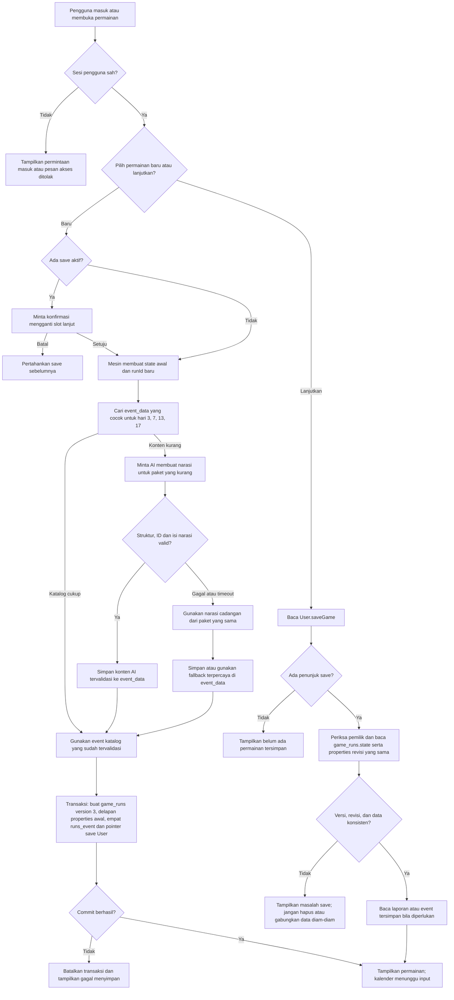
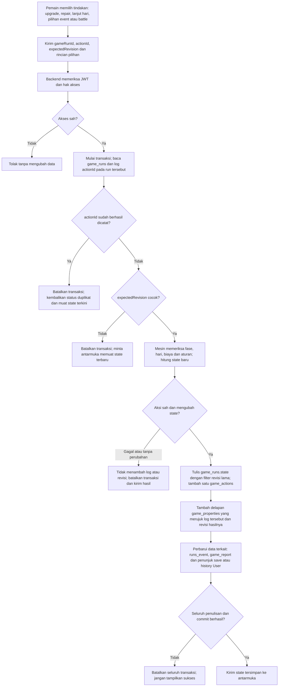
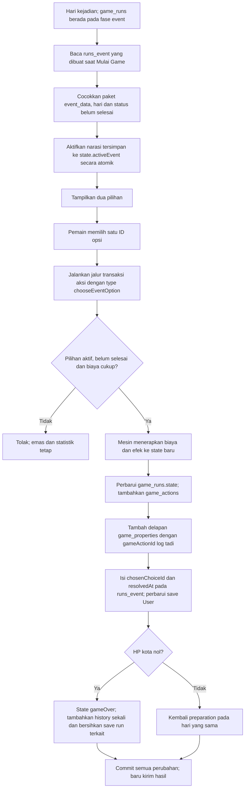
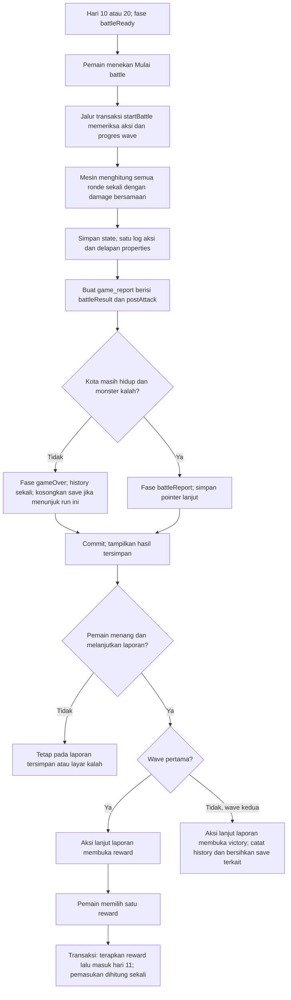
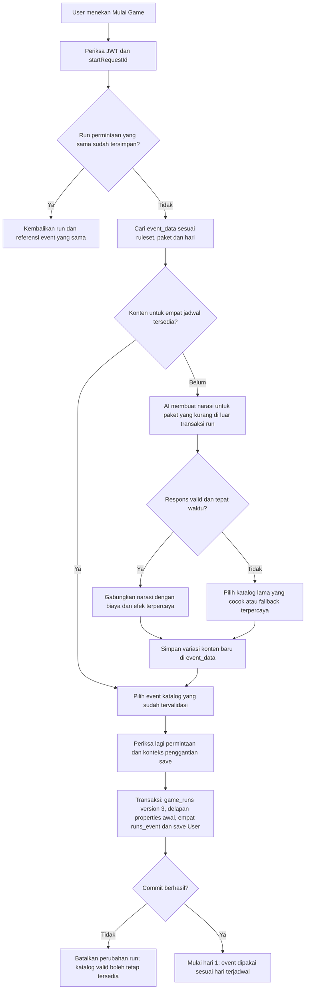
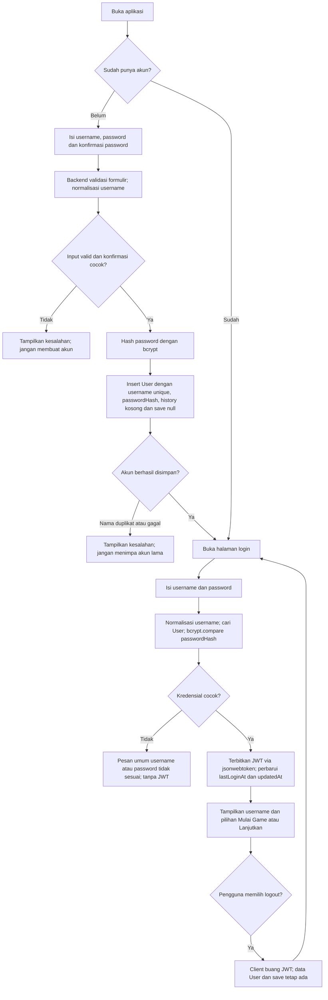

# Alur proses database

Dokumen ini menjelaskan rancangan penyimpanan untuk game single-player. Nama koleksi mengikuti [schema_new.completed.drawio](schema_new.completed.drawio). Detail field ada di [Database_proposal.md](Database_proposal.md). Diagram yang dapat diedit: [database_flow.drawio](database_flow.drawio).

> **Catatan:** beberapa langkah di bawah masih menyebut hari event tetap 3/7/13/17 dan `version: 3`. Engine aktif memakai `eventPlan` per run dan `version: 4` — lihat [`../game-engine/README.md`](../game-engine/README.md). Sesuaikan alur create-run saat mengimplementasikan persistensi.

Alur ini adalah rancangan integrasi Next.js, mesin permainan, dan MongoDB. Status implementasi backend aktual ada di `app/docs/` (bukan diasumsikan dari teks historis “belum diimplementasikan” saja). Tidak ada seeding data dalam dokumen ini.

## 1. Mulai baru atau lanjutkan permainan

Delapan properties awal memiliki revision 0 dan gameActionId null. Pembuatan run bukan aksi gameplay yang menambah revisi. User.saveGame hanya menunjuk run dan revisi; state lengkap tetap di game_runs.

Saat lanjut permainan, backend tidak menjalankan ulang pemasukan, pertempuran, efek kejadian atau reward. Kalender otomatis milik frontend juga tidak boleh langsung berjalan setelah load.

## 2. Tindakan pemain sampai berhasil tersimpan

Pada setiap aksi yang berhasil mengubah state, mesin menaikkan revision tepat satu kali. Backend tidak menambahkan revisi kedua. game_properties berisi delapan nilai: gold, cityHp, cityMaxHp, wallLevel, troopLevel, cityLevel, attack, dan defense. Semuanya berasal dari hasil mesin dan selector pada revisi yang sama.

MongoDB memerlukan replica set atau deployment yang mendukung transaksi beberapa dokumen untuk alur ini. Konflik penulisan dapat mengharuskan transaksi dicoba ulang, tetapi expectedRevision dan actionId asal tetap diperiksa. Backend tidak boleh mengubah permintaan lama menjadi aksi baru secara otomatis.

## 3. Pilihan kejadian yang mengubah statistik kota

Hubungan runs_event tetap ke game_runs melalui gameRunId. Untuk mengetahui perubahan stat akibat pilihan, ikuti game_actions bertipe chooseEventOption, kemudian game_properties melalui gameActionId. Tidak diperlukan referensi langsung dari runs_event ke setiap baris properties.

Narasi yang dibuat saat Mulai Game belum menerapkan efek. Pemasangan narasi yang mengubah state tetap memakai pemeriksaan revisi dan dicatat sebagai aksi attachActiveEvent beserta snapshot statistik. Respons terlambat harus diabaikan jika run sudah berganti, event selesai atau narasi cadangan sudah dipilih. Jika commit gagal pada langkah mana pun, seluruh perubahan terkait dibatalkan.

Pilihan event tidak memakai jatah aksi ekonomi dan tidak memberikan pemasukan hari itu lagi. Bonus pertahanan atau diskon tersimpan di effects pada state lengkap agar durasinya tetap benar.

## 4. Pertempuran, laporan, reward, dan akhir permainan

Setiap aksi setelah laporan juga mengikuti transaksi pada alur nomor 2. game_report tetap menjadi catatan saat battle selesai; reward dan progres berikutnya tidak menimpa postAttack.

Kota HP nol selalu kalah, termasuk ketika monster juga nol pada ronde yang sama. Indeks unik `gameRunId` dan `wave` mencegah laporan wave yang sama ditulis dua kali, tanpa membatasi jumlah wave di sepanjang run (schema siap ~100 hari). Backend tetap memeriksa log dan revisi. Membaca laporan setelah refresh tidak menerapkan damage lagi. Outcome event tidak memakai `game_report` — dicatat di `runs_event` plus `game_actions`/`game_properties`.

## 5. Koneksi terputus atau pengguna keluar akun

| Keadaan | Yang dilakukan aplikasi |
|---|---|
| Pengguna keluar akun setelah save berhasil | Client buang JWT; simpan tetap ada di database |
| Koneksi terputus sebelum transaksi selesai | Jangan menganggap aksi berhasil; periksa hasil server ketika tersambung |
| Transaksi sudah commit tetapi respons tidak sampai | Muat state terbaru atau periksa actionId yang sama; jangan memotong biaya lagi |
| Permintaan dicoba ulang dan actionId sudah tercatat | Tanggapi sebagai duplikat; jangan menjalankan aksi dua kali |
| Transaksi sudah dibatalkan | Tidak ada perubahan parsial; retry tetap memakai identitas permintaan asal |
| Save menunjuk revisi yang tidak cocok dengan state | Tampilkan masalah dan lakukan rekonsiliasi backend; jangan campur revisi properties |

Selesainya request jaringan di sisi browser tidak selalu membuktikan transaksi sudah commit. Karena itu server menjadi acuan hasil penyimpanan. Rancangan ini belum mencakup bermain offline penuh atau penambahan hari berdasarkan waktu saat pemain tidak aktif.

## 6. AI membuat event yang disimpan untuk dipakai ulang

### Perbedaan kedua koleksi

| Koleksi | Isi dan pemilik data |
|---|---|
| event_data | Cerita, label pilihan, biaya/efek terpercaya, paket, hari dan asal konten. Katalog bersama yang dapat digunakan banyak pemain |
| runs_event | Hubungan antara gameRunId dan eventDataId, salinan narasi saat dipilih, pilihan pengguna dan waktu penyelesaian. Bersifat per sesi permainan |

Satu dokumen event_data dapat dirujuk banyak runs_event. Mengambil pilihan hanya mengubah progres pemain terkait; tidak mengubah katalog bersama. Efek tidak diterapkan saat AI selesai menulis atau saat event disimpan.

### Urutan penyimpanan

1. Baca paket biaya/efek yang dipercaya dari konfigurasi engine dan cari katalog yang sesuai. Katalog bukan sumber angka AI arbitrer.
2. Jika konten kurang, minta AI membuat narasi, validasi struktur/ID/teks, gabungkan dengan paket terpercaya, lalu simpan ke event_data. Jangan memegang transaksi run selama request AI.
3. Pilih empat event katalog, satu untuk setiap jadwal hari 3, 7, 13, 17. AI tidak harus dipanggil pada setiap permainan jika katalog sudah cukup; generasi baru dapat memperbanyak variasi yang dapat dipakai ulang.
4. Dalam transaksi awal, buat game_runs (`version: 3`) revision 0, delapan properties awal dan empat runs_event yang merujuk eventDataId terpilih, lalu perbarui User.saveGame. Setiap runs_event awal memiliki chosenChoiceId/resolvedAt null. activeEvent hari pertama tetap null.
5. Jika transaksi awal gagal, save lama tetap utuh. Katalog valid yang sudah tersimpan boleh tetap ada untuk permainan lain. Jika permintaan Mulai Game diulang setelah sukses, kembalikan run/event yang sama.

### Validasi, indeks dan reuse

Narasi bersama harus umum, tanpa data pribadi atau klaim keadaan spesifik pemain. Cocokkan ruleset, packageId dan day sebelum dipakai. source bernilai ai/mock/fallback; reuse konten AI tetap source ai. Salinan narrative pada runs_event membekukan yang benar-benar diterima pemain; jangan menimpanya dengan generasi baru.

Satu paket dapat memiliki banyak variasi: gunakan _id event_data yang unik per cerita. packageId boleh berulang pada beberapa dokumen katalog, sehingga indeks gameRulesetId + packageId + day adalah indeks pencarian, bukan unique. Unique gameRunId + eventId tetap dibutuhkan pada runs_event. Unique userId + startRequestId diperlukan untuk permintaan Mulai Game.

ID pilihan, batas panjang teks dan efek diverifikasi backend. Respons terlambat setelah fallback atau pergantian run harus diabaikan untuk run tersebut. Refresh/load hanya membaca narasi yang sudah ditautkan. Pilihan efek tetap dijalankan melalui chooseEventOption dan transaksi aksi pada diagram sebelumnya.

Semua ini masih rancangan. Kontrak engine ActiveEvent.source perlu diperluas untuk ai; backend AI, indeks katalog dan persistence belum diimplementasikan.

## 7. Register, login dan logout dengan username/password

Nama pengguna adalah identitas masuk sekaligus nama tampilan. Email, authSubject dan displayName tidak digunakan. Backend menyimpan username yang sudah dinormalisasi dan memberi indeks unik. Password asli tidak masuk database atau log.

Akun belum pernah login memiliki `lastLoginAt` null. JWT memuat `User._id`; setiap endpoint game memeriksa kepemilikan run. Login tidak mengubah revision permainan. Secret JWT dan masa berlaku diatur saat implementasi; bagian ini bukan klaim fitur login sudah berfungsi.
