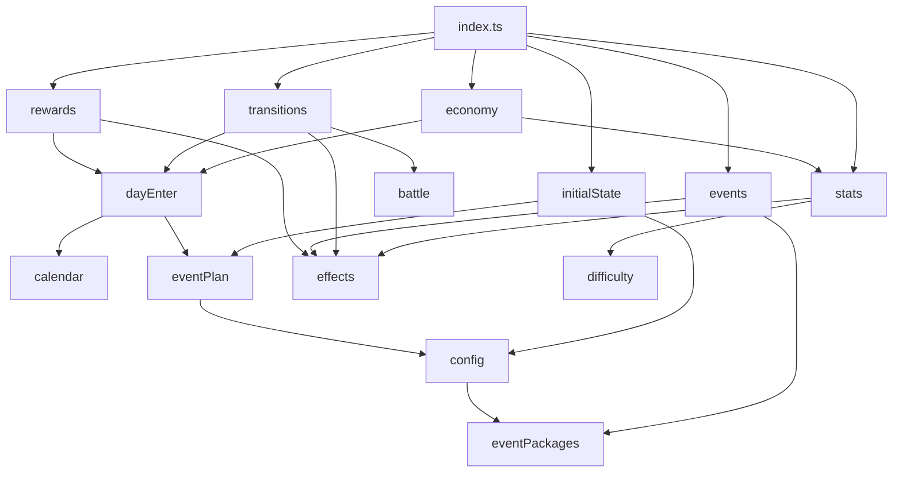

# Arsitektur Game Engine

## Peta modul (`src/game`)

| File | Tanggung jawab |
|---|---|
| [`types.ts`](../../src/game/types.ts) | Tipe state, fase, efek, error, reward, event |
| [`config.ts`](../../src/game/config.ts) | `GAME_STATE_VERSION`, `gameConfig`, wave, reward, helper lookup |
| [`difficulty.ts`](../../src/game/difficulty.ts) | Modifier easy/normal/hard + fungsi skala |
| [`initialState.ts`](../../src/game/initialState.ts) | `createInitialState` |
| [`calendar.ts`](../../src/game/calendar.ts) | Hari battle/prep, segmen, income, antrian consequence per hari |
| [`dayEnter.ts`](../../src/game/dayEnter.ts) | `enterCalendarDay` (internal), `hasUnresolvedEvent` |
| [`stats.ts`](../../src/game/stats.ts) | Attack/defense efektif, biaya, preview wave |
| [`economy.ts`](../../src/game/economy.ts) | Upgrade tiga jalur + repair |
| [`effects.ts`](../../src/game/effects.ts) | Penerapan efek, diskon, pembersihan bonus timed |
| [`battle.ts`](../../src/game/battle.ts) | `resolveBattle` murni |
| [`transitions.ts`](../../src/game/transitions.ts) | Lanjut hari, start battle, laporan, surrender |
| [`eventPackages.ts`](../../src/game/eventPackages.ts) | Paket terjadwal + consequence + successor map |
| [`eventPlan.ts`](../../src/game/eventPlan.ts) | `pickEventPlan`, resolve/shift entri rencana |
| [`activeEvent.ts`](../../src/game/activeEvent.ts) | Builder `ActiveEvent` + scaling biaya pilihan |
| [`events.ts`](../../src/game/events.ts) | Attach, ensure local, pilih opsi event |
| [`narrative.ts`](../../src/game/narrative.ts) | Overlay narasi aman (label/title/description) |
| [`rewards.ts`](../../src/game/rewards.ts) | `chooseReward` |
| [`result.ts`](../../src/game/result.ts) | `ok` / `fail` / `isEnded` (internal) |
| [`index.ts`](../../src/game/index.ts) | Re-export API publik |

## Hubungan modul



Alur mutasi tipikal: pemanggil membaca state → memanggil satu fungsi aksi → menerima `ActionResult` → jika `ok`, mengganti state dengan `result.state` secara atomik.

## Public API versus helper internal

**Publik** (diekspor dari [`index.ts`](../../src/game/index.ts)): lihat daftar lengkap di [API_AND_INTEGRATION.md](./API_AND_INTEGRATION.md).

**Internal (tidak diekspor), penting dipahami:**

| Simbol | File | Catatan |
|---|---|---|
| `enterCalendarDay` | `dayEnter.ts` | Dipakai `endPreparationDay` dan `chooseReward` |
| `ok` / `fail` / `isEnded` | `result.ts` | Pembentuk `ActionResult` |
| `applyEffects` / `emptyEffects` | `effects.ts` | Digunakan event/reward/transisi |
| `pendingConsequenceForDay` | `calendar.ts` | Antrian consequence |
| `toConsequenceActiveEvent` | `activeEvent.ts` | Builder consequence |
| `rawUpgradeCost` / `trackLevel` | `effects.ts` / `stats.ts` | Biaya sebelum diskon |

Jangan memanggil `enterCalendarDay` dari FE/BE. Lompatan kalender publik tidak didukung.

## Struktur `GameState`

```ts
type GameState = {
  version: 4;
  revision: number;
  runId: string;
  difficulty: "easy" | "normal" | "hard";
  day: number;
  phase: GamePhase;
  gold: number;
  cityHp: number;
  cityMaxHp: number;
  wallLevel: number;
  troopLevel: number;
  cityLevel: number;
  actionUsedToday: boolean;
  incomeGrantedDays: number[];
  completedEventIds: string[];
  eventPlan: EventPlanEntry[];       // biasanya length 20
  pendingConsequences: PendingConsequence[];
  activeEvent: ActiveEvent | null;
  effects: ActiveEffects;
  wavesCleared: number;
  battleResult: BattleResult | null;
  rewardsChosenByWave: Record<string, string>;
};
```

### Nilai turunan (jangan disimpan terpisah di engine)

Attack, defense, biaya upgrade/repair, income hari ini, dan preview monster dihitung ulang lewat selector (`getEffectiveStats`, `getWavePreview`, dll.). Menyimpan total turunan di state berisiko tidak sinkron.

### Penanda progres

| Field | Fungsi |
|---|---|
| `incomeGrantedDays` | Mencegah income ganda per hari |
| `actionUsedToday` | Satu aksi ekonomi sukses per hari prep |
| `completedEventIds` | Event / consequence yang sudah selesai |
| `eventPlan` | Jadwal terjadwal run ini |
| `pendingConsequences` | Consequence menunggu `triggerDay` |
| `wavesCleared` | Wave terakhir yang dimenangkan |
| `rewardsChosenByWave` | Reward yang sudah diambil per wave |
| `battleResult` | Hasil battle hari ini (mencegah re-resolve) |
| `revision` | Deteksi stale write di lapisan pemanggil |

## Fungsi murni, serialisasi, `ActionResult`

- Fungsi aksi menerima snapshot state dan mengembalikan state baru atau error; state input tidak dimutasi in-place.
- State hanya berisi objek/array/string/number/boolean — aman di-JSON.
- Bentuk hasil:

```ts
type ActionResult =
  | { ok: true; state: GameState }
  | { ok: false; error: { code: GameErrorCode; message: string } };
```

Jika `ok: false`, state asal pemanggil tetap dipakai. `message` untuk debugging/log; UI sebaiknya mengandalkan `code`.

## Transaksi atomik dan pencegahan aksi ganda

- Validasi dilakukan sebelum mutasi. Gagal = tidak ada field yang berubah.
- Biaya + efek event diterapkan dalam satu langkah (`chooseEventOption`).
- Reward + masuk hari berikutnya digabung di `chooseReward`.
- Battle dihitung sekali di `startBattle`; hasil disimpan di `battleResult`. Memuat ulang laporan tidak memanggil `resolveBattle` lagi.
- `revision` naik hanya pada jalur sukses. Pemanggil (BE) harus menolak aksi dengan `expectedRevision` usang.
- Mengulang aksi pada state yang sama setelah sukses biasanya ditolak (`NO_ACTION_LEFT`, `BATTLE_ALREADY_RESOLVED`, `REWARD_ALREADY_CHOSEN`, `EVENT_ALREADY_RESOLVED`, dll.).

## Batas tanggung jawab lintas lapisan

| Concern | Engine | FE / BE / harness |
|---|---|---|
| Narasi event | Menerima overlay lewat `decorateActiveEvent`; menolak label yang menyatakan angka currency | Generate AI, timeout, fallback HTTP |
| Timer / animasi | Tidak ada | Interval 5 detik, playback log |
| Jaringan | Tidak ada | Fetch mock/AI, proxy |
| Storage | Tidak ada | MongoDB produk, `localStorage` harness |
| Balancing runtime | Config compile-time di `config.ts` / `difficulty.ts` | Tidak mengubah rumus di UI |

## Helper legacy / no-op yang masih diekspor

| Export | Perilaku aktual |
|---|---|
| `scheduledEventDays()` | Selalu `[]` — hari event dari `eventPlan` |
| `eventPackagesForDay(_day)` | Selalu `[]` |
| `eventPackageForDay(day, planPackageId?)` | Hanya resolve jika `planPackageId` diberikan |

Integrasi baru harus memakai `pickEventPlan` / `resolveEventPackage` / `state.eventPlan`, bukan helper legacy di atas.
