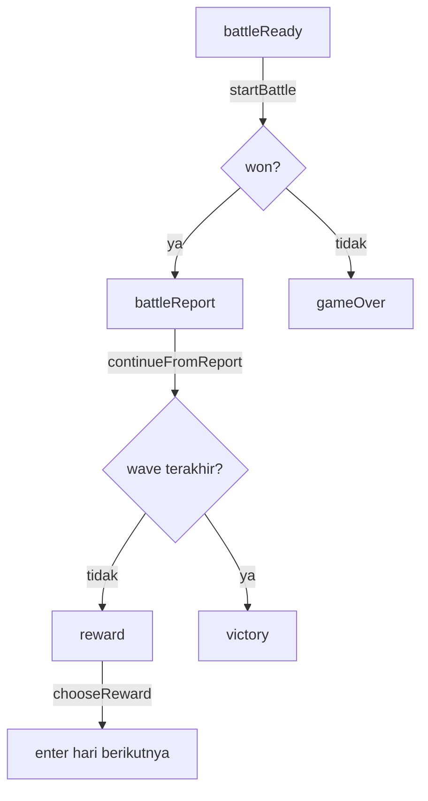

# Alur Permainan

Dokumen ini membedakan **aksi pemain** (API publik yang dipanggil UI/BE) dan **proses otomatis engine** (income, buka event, hitung battle).

## Diagram fase

```mermaid
stateDiagram-v2
  [*] --> preparation: createInitialState
  preparation --> event: enter day dengan event/consequence
  event --> preparation: chooseEventOption (hari tanpa antrian lagi)
  event --> event: chooseEventOption membuka event wajib berikutnya hari yang sama
  preparation --> preparation: endPreparationDay ke hari prep tanpa event
  preparation --> battleReady: endPreparationDay / chooseReward ke hari battle
  battleReady --> battleReport: startBattle menang
  battleReady --> gameOver: startBattle kalah / HP 0
  battleReport --> reward: continueFromReport wave 1-9
  battleReport --> victory: continueFromReport wave 10
  reward --> preparation: chooseReward masuk hari berikutnya
  reward --> event: chooseReward hari berikutnya punya event
  reward --> battleReady: (tidak biasa; hari+1 jarang battle langsung dari reward wave)
  preparation --> gameOver: damage event fatal / surrender
  event --> gameOver: damage event fatal / surrender
  reward --> gameOver: surrender
  battleReady --> gameOver: surrender
  battleReport --> gameOver: surrender atau laporan kalah
  gameOver --> [*]
  victory --> [*]
```

Catatan: `chooseReward` selalu `enterCalendarDay(day + 1)`. Setelah wave di hari N, hari N+1 adalah hari prep decade berikutnya (bukan battle).

## Transisi inti

| Dari | Pemicu | Syarat | Perubahan utama | Penolakan tipikal |
|---|---|---|---|---|
| — | `createInitialState` | — | Hari 1, prep, income hari 1 sekali, `eventPlan` | — |
| `preparation` | upgrade/repair | Prep, belum aksi, event selesai, gold/level/HP valid | Level/HP/gold, `actionUsedToday` | `EVENT_REQUIRED`, `NO_ACTION_LEFT`, `INSUFFICIENT_GOLD`, … |
| `preparation` / `event`* | `endPreparationDay` | Tidak ada event unresolved; hari prep | `enterCalendarDay(day+1)` | `EVENT_REQUIRED`, `INVALID_PHASE` |
| `event` | `chooseEventOption` | Pilihan valid, gold cukup | Biaya+efek, selesai, mungkin buka event berikutnya | `INVALID_CHOICE`, `INSUFFICIENT_GOLD` |
| `battleReady` | `startBattle` | Hari battle, belum di-resolve | `battleResult`, HP, fase report/over | `BATTLE_ALREADY_RESOLVED`, `BATTLE_INVALID` |
| `battleReport` | `continueFromReport` | Ada `battleResult` | → `reward` / `victory` / `gameOver` | `INVALID_PHASE` |
| `reward` | `chooseReward` | ID trio wave ini, belum dipilih | Efek reward + masuk hari berikutnya | `REWARD_ALREADY_CHOSEN`, `INVALID_CHOICE` |
| Fase hidup | `surrender` | Belum ended | `phase: gameOver` | `GAME_ENDED` |

\* `endPreparationDay` menerima `phase === "event"` hanya jika `hasUnresolvedEvent` sudah false (jalur pemulihan tidak biasa).

## Masuk hari (otomatis)

`enterCalendarDay` (internal) saat lanjut hari / setelah reward:

1. Reset `actionUsedToday = false`, bersihkan `activeEvent` default.
2. Jika hari battle → `battleReady`, **tanpa** income.
3. Jika hari prep → grant income sekali (jika belum di `incomeGrantedDays`).
4. Jika ada consequence unresolved untuk hari itu → aktifkan consequence (`phase: "event"`), geser event terjadwal yang bentrok (`shiftPlanEntryDay`).
5. Else jika ada paket terjadwal unfinished → `phase: "event"`.
6. Else → `preparation`.

## Income

- Hanya hari prep.
- Sekali per hari, termasuk hari 1 di `createInitialState`.
- Tidak ada income di hari 10, 20, …, 100.
- Rumus: lihat [CONFIGURATION.md](./CONFIGURATION.md).

## Aksi ekonomi dan skip

**Pemain:** `upgradeWall` | `upgradeTroops` | `upgradeCity` | `repairCity`.

- Maksimal **satu sukses** per hari prep (`actionUsedToday`).
- Gagal (gold kurang, max level, HP penuh, fase salah) **tidak** menghabiskan jatah.
- Skip diperbolehkan: langsung `endPreparationDay` tanpa aksi.
- Jatah tidak terakumulasi ke hari berikutnya.
- Diblokir jika ada event unresolved.

## Event

**Pemain:** `chooseEventOption(choiceId)`; opsional `attachActiveEvent` / `decorateActiveEvent` / `ensureLocalEvent` untuk narasi/recovery.

- Wajib selesai sebelum belanja atau lanjut hari.
- Setelah memilih, engine dapat langsung membuka event/consequence wajib lain di **hari yang sama**.
- Detail paket: [EVENTS_AND_REWARDS.md](./EVENTS_AND_REWARDS.md).

## Battle, laporan, reward

- `startBattle` menghitung seluruh ronde sekaligus, menyimpan log, menerapkan HP akhir.
- Wave biasa (1–9) menang → laporan → reward wajib → hari berikutnya.
- Wave terakhir (10) menang → laporan → `victory` (tanpa reward).
- Kalah (kota HP 0, termasuk mutual kill) → `gameOver` langsung dari `startBattle`.
- HP kota tersisa dibawa ke segmen berikutnya.

## Surrender dan HP nol

- `surrender` dari fase hidup mana pun → `gameOver` (bukan hanya dari battle).
- HP kota 0 dari battle atau efek `damageCity` → `gameOver`.

## Consequence

- Dijadwalkan saat pilihan punya `consequence` (biasanya skip/refuse).
- Delay `minDelayDays`–`maxDelayDays` (biasanya 1–3), prefer jendela prep sebelum `CONSEQUENCE_TARGET_WAVE`.
- Jika jendela penuh → ganti ke paket `CONSEQUENCE_SUCCESSOR`.
- Saat `triggerDay` tiba, consequence menang atas event terjadwal (jadwal digeser).

## Contoh: hari 1 sampai battle pertama (normal)

Asumsi: `runId` menghasilkan eventPlan dengan event di hari 3 dan 7 (contoh ilustratif; hari aktual bergantung hash `runId`).

| Hari | Otomatis | Pemain | Catatan |
|---:|---|---|---|
| 1 | Income 28; gold 128; prep | Opsional 1 aksi ekonomi | Tidak ada event terjadwal di hari 1 |
| 2 | Income; prep | Aksi atau skip → lanjut | |
| 3 | Income; buka event jika direncanakan | Pilih opsi event → lalu aksi/lanjut | |
| 4–9 | Income tiap prep; event lain jika ada | Aksi/skip/lanjut | |
| 10 | Masuk `battleReady`, tanpa income | `startBattle` → laporan | Monster Goblin 150/22 |
| 10+ | — | `continueFromReport` → `reward` | Pilih 1 dari 3 |
| 11 | Income + masuk decade 2 | Lanjut siklus | |

## Ringkasan siklus sampai hari 100

Untuk tiap decade `n = 1…10`:

1. Hari prep di segmen (kecuali battle): income, hingga 2 event terjadwal, consequence jika ada, ≤1 aksi ekonomi/hari.
2. Hari `10n`: battle wave `n`.
3. Jika menang dan `n < 10`: reward → lanjut.
4. Jika menang dan `n = 10`: victory.
5. Jika kalah kapan saja: game over.

Total: 90 hari prep potensial + 10 battle; `eventPlan` default 20 entri terjadwal, plus consequence dinamis.
