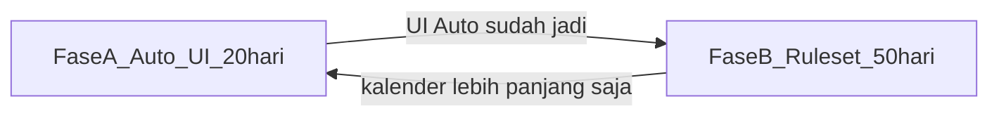

# Auto Run (20 hari dulu, 50 hari kemudian)

## Jawaban singkat

**Masukkan Auto di prototipe 20 hari** supaya FE menyesuaikan desain sekarang. Perilaku Auto tidak tergantung panjang kampanye; ia hanya memanggil `endPreparationDay`. Ruleset 50 hari belakangan memakai UI Auto yang sama.

## Keputusan terkunci

- **Engine tidak punya timer/auto.**
- **Auto = fitur frontend**; interval **5 detik**; default **Manual**.
- Auto **tidak** belanja / event / reward / battle.
- Belanja tidak dipakai: auto boleh lanjut; UI tampilkan “aksi masih tersedia” + countdown.
- Acuan: [../.scratch/kalender-manual-auto/spec.md](../.scratch/kalender-manual-auto/spec.md).
- 50 hari: [PRD.md](../PRD.md) §12 — setelah prototipe 20 oke.

## Fase A — Prototipe 20 hari (FE mulai sekarang)

| Deliverable FE | Detail |
|---|---|
| Toggle Manual / Auto | Default Manual tiap new game & load |
| Status | Berjalan / Dijeda + alasan |
| Countdown | 5 detik sebelum tick |
| Lanjutkan auto | Wajib setelah jeda keputusan |
| Indikator aksi | Aksi ekonomi masih tersedia |
| Scheduler | `AutoRunController`; cancel on Manual / refresh / new run |

## Fase B — Produksi 50 hari

Config-driven waves/events; playtest Auto tanpa redesign UI.

## Spek & tiket

- Spek: [../.scratch/kalender-manual-auto/spec.md](../.scratch/kalender-manual-auto/spec.md) (`ready-for-agent`, diselaraskan plan ini)
- Tiket: [../.scratch/kalender-manual-auto/issues/](../.scratch/kalender-manual-auto/issues/) 01–03

## Todos

- [ ] Fase A: AutoRunController + UI di FE (tiket 01–03)
- [ ] Fase A: tes controller + playtest Auto 20 hari
- [ ] Fase B: config kampanye 50 hari + tes engine (spek terpisah nanti)
- [ ] Fase B: playtest Auto pada ruleset 50

