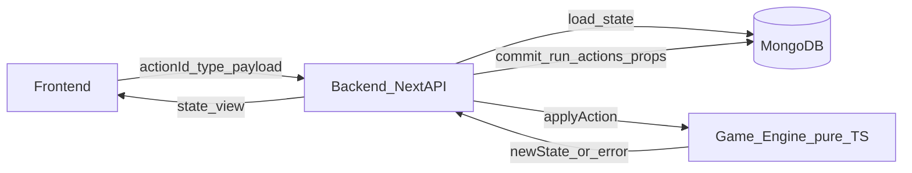

# Daftar Modul Game Engine

> **Historis (6 Nov 2026, kampanye 20 hari).** Engine yang berjalan adalah 100 hari / 10 wave / `maxTrackLevel` 18. Paket event dinamis: [app/docs/AI_EVENT_RUNTIME.md](../app/docs/AI_EVENT_RUNTIME.md).

Versi diskusi · Keputusan terkunci 6 Nov 2026 · Belum implementasi kode

## Keputusan terkunci

- Ekonomi: tiga jalur upgrade (tembok DEF, pasukan ATK, kota MaxHP+income) + repair; **tanpa** unit individual. Lihat [split-three-upgrades.md](split-three-upgrades.md). Keputusan lama "satu upgrade ATK+DEF" sudah diganti.
- Lingkup engine: murni TypeScript + kontrak typed ke `game_runs.state` / aksi; **bukan** Mongo/auth/UI produk.
- Acuan aturan: [AGENTS.md](../AGENTS.md), [PRD.md](../PRD.md) v2, [MVP.md](../MVP.md) v2, state di [Database_proposal.md](../docs/database/Database_proposal.md). Tugas FE/BE: [README.md](../README.md).
- Inspirasi [1in8b](https://1in8b.life/en/): kalender + event pilihan yang mengubah trajectory kota.
- Panjang: prototipe **20 hari / 2 wave**; setelah prototipe oke → produksi **50 hari / 5 wave** (PRD §12). Jadwal dari config/ruleset, bukan day-picker.
- Spek + tiket implementasi: [.scratch/game-engine-prototype/](../.scratch/game-engine-prototype/) (seam = API publik engine).

## Batas tanggung jawab

| Modul di bawah | Pemilik |
|---|---|
| `src/game/*` aturan + test | Engine |
| Kontrak `GameState` / `GameAction` / error codes | Engine tulis; BE+FE konsumsi |
| `game_runs`, `game_actions`, auth, AI catalog | Backend |
| Dashboard, animasi battle, halaman | Frontend |
| Mock harness (opsional) | Engine, terpisah dari UI produk |

---

## Modul engine yang perlu dibuat

Struktur usulan di `src/game/` (nama boleh disesuaikan, isi wajib):

### 1. `types.ts` — kontrak data

- `GamePhase`: `preparation | event | battleReady | battleReport | reward | gameOver | victory`
- `GameState` selaras schema: `version` 3, `revision`, `runId`, `day`, `phase`, `gold`, `cityHp`, `cityMaxHp`, `wallLevel`, `troopLevel`, `cityLevel`, `actionUsedToday`, `incomeGrantedDays`, `activeEvent`, `completedEventIds`, `effects`, `wavesCleared`, `battleResult`, `rewardChosenId`
- Discriminated unions: `GameEffect`, `GameAction`, `GameError` (kode untuk UI, bukan string bebas)
- JSON-serializable saja (tanpa `Date`/`Map`/`class`)

### 2. `config.ts` — angka terpusat

- Gold awal, income, HP, base ATK/DEF, biaya upgrade bertingkat, bonus upgrade, max level, repair cost/heal
- Wave 1/2 monster, jadwal event hari 3/7/13/17, paket efek event, 3 reward
- Satu sumber kebenaran; BE boleh mirror ke `game_ruleset.config` nanti

### 3. `initialState.ts`

- Buat run baru: income hari 1 sekali, `revision` awal, `phase`/`day` valid
- Tidak sentuh DB

### 4. `stats.ts` — selector turunan

- `getEffectiveAttack` dari `troopLevel`; `getEffectiveDefense` dari `wallLevel` + efek wave
- `getUpgradeCost(state, track)` (ceil setelah diskon max), `getRepairCost`, wave preview
- Jangan simpan total ATK/DEF di state (kecuali snapshot di dalam `battleResult`)

### 5. `calendar.ts`

- Hari persiapan vs battle; jadwal event; grant income sekali per hari persiapan
- Helper: apakah belanja/lanjut hari diizinkan di fase ini

### 6. `economy.ts`

- Aksi: `upgradeWall`, `upgradeTroops`, `upgradeCity`, `repairCity` (max 1 sukses/hari; gagal tidak makan jatah)
- Validasi fase, gold, max level, HP penuh; transaksi atomik

### 7. `battle.ts`

- Fungsi murni: snapshot kota+monster → `battleResult` + log ronde
- Damage simultan; kota damage `max(1, atk − def)`; tie keduanya nol = kalah
- Tidak ada timer/random

### 8. `effects.ts`

- Terapkan/hapus efek: `grantGold`, `damageCity`, `nextWaveDefense`, `upgradeDiscount`
- Diskon tidak stack (ambil rate terbesar); expiry setelah wave target / fase reward

### 9. `events.ts`

- Terima event tervalidasi (paket lokal / dari BE); `chooseEvent(choiceId)`
- Minimal 1 pilihan gratis; tolak gold kurang / choice invalid / double apply

### 10. `rewards.ts`

- Tepat 3 pilihan setelah wave 1; sekali pilih; bonus income/diskon hanya hari 11–19

### 11. `transitions.ts`

- Mesin fase: end day → event/battleReady; start battle → battleReport; report → reward/victory/gameOver; reward → day 11
- HP 0 dari sumber mana pun → `gameOver`

### 12. `index.ts` — API publik

Setara: `createGame`, `upgrade`, `repair`, `chooseEvent`, `endDay`, `startBattle`, `continueReport`, `chooseReward`, plus selectors.

Pola: `(state, action) → { state } | { error }` atau Result type; naikkan `revision` hanya jika state berubah.

### 13. `game.test.ts` (+ integration 20 hari)

- Cover wajib di AGENTS: income, 1 aksi/hari, upgrade/repair, battle edge, event/reward, serialisasi, no re-battle on reload

### 14. Kontrak integrasi (doc singkat, bukan kode DB)

- Mapping `GameState` ↔ `game_runs.state`
- Daftar `GameAction.type` yang BE boleh commit ke `game_actions`
- Field yang BE isi di luar engine: `userId`, `rulesetId`, timestamps, `game_properties` snapshot (ATK/DEF hasil selector saat commit)
- Engine **tidak** menulis Mongo; BE memanggil engine lalu persist

### Di luar daftar engine inti (boleh belakangan)

- `src/dev-harness/*` + mock event server — hanya untuk uji engine sendiri
- Auth, AI generate, animasi UI

---

## Urutan bangun (saat nanti eksekusi)

1. `types` + `config` + `initialState` + `stats`
2. `economy` + `calendar` + `transitions` (hari 1–9 tanpa event dulu)
3. `battle` + lanjut ke reward/victory
4. `effects` + `events` + `rewards`
5. Test integration 20 hari
6. Dokumen kontrak 1 halaman untuk BE/FE

## Todos diskusi

- [x] PRD/MVP/README v2.1 ditulis untuk FE/BE (tiga jalur upgrade; state version 3; tanpa rekrut unit)
- [ ] Diskusi detail shape GameState (effects, activeEvent, battleResult)
- [ ] Diskusi daftar GameAction types + error codes untuk BE/FE
- [ ] Samakan nama fase battle vs battleReady di engine/schema/UI
- [ ] Implementasi `src/game/*` + tests setelah diskusi selesai

## Yang perlu diskusi detail berikutnya (satu topik per giliran)

1. Shape exact `GameState.effects` dan `activeEvent`
2. Daftar `GameAction` + error codes
3. Nama fase: `battle` (PRD) vs `battleReady` (AGENTS) — pilih satu untuk schema/UI
4. Apakah `game_properties` ATTACK/DEFENSE diisi BE dari selector engine setiap commit
5. Update [Todos.md](../Todos.md) agar milestone tidak lagi menyebut rekrutmen/tembok
