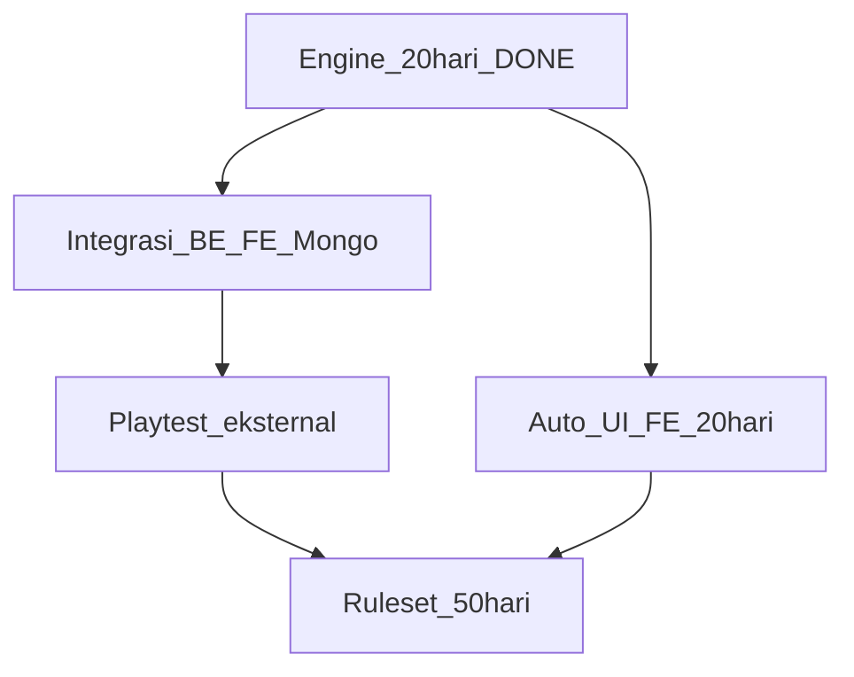

# Roadmap hasil diskusi (selain feature freeze)

> Arsip proyek. Target, contoh dan hasil pemeriksaan di bawah mengikuti tahap pekerjaan saat dicatat. Untuk aturan kampanye yang berjalan sekarang, lihat [PRD](../PRD.md).

Versi diskusi · November 2026

Freeze fitur spekulatif: [feature-freeze-playtest.md](feature-freeze-playtest.md).  
Auto 20→50: [auto-run-20-dan-50.md](auto-run-20-dan-50.md).

Dokumen ini = pekerjaan yang **sudah disepakati** agar tim bisa maju.

## Keputusan produk terkunci

| Topik | Keputusan |
|---|---|
| Ekonomi | Tiga jalur upgrade (tembok/DEF, pasukan/ATK, kota/MaxHP+income) + repair; **tanpa** rekrut unit / build-time N hari |
| Prototipe | **20 hari / 2 wave**; Manual **Lanjut hari** wajib ada |
| Auto | **FE only**, boleh di **20 hari** agar FE desain sekarang; interval 5s; jeda event/battle/reward; tidak auto-beli |
| Produksi nanti | **50 hari / 5 wave** lewat ruleset baru (PRD §12), UI Auto sama |
| Engine | Murni TS; kontrak `GameState` v3 / aksi untuk BE+FE; siap integrasi di `src/game` |
| Persistensi | Mongo per schema; BE commit setelah panggil engine |

Acuan: [PRD.md](../PRD.md), [MVP.md](../MVP.md), [README.md](../README.md), [DEV1_CONTRACT.md](../docs/DEV1_CONTRACT.md), [game-engine-modules.md](game-engine-modules.md).

## Yang sudah selesai (jangan buat ulang)

- Engine prototipe + tes 20 hari: [../.scratch/game-engine-prototype/](../.scratch/game-engine-prototype/) (tiket 01–07 done)
- Tiga jalur upgrade di engine (v3): [split-three-upgrades.md](split-three-upgrades.md), [../.scratch/split-three-upgrades/](../.scratch/split-three-upgrades/)
- Spek Auto: [../.scratch/kalender-manual-auto/](../.scratch/kalender-manual-auto/) (spek + 3 tiket — selaraskan dengan “Auto di 20 hari dulu”)

## to-spec + to-tickets (setelah roadmap disetujui)

Issue tracker lokal (bukan GitHub):

### 1. Auto Run FE (selaraskan spek existing)

- Path: `.scratch/kalender-manual-auto/`
- **Seam uji:** `AutoRunController` → handler `endPreparationDay` yang sama dengan tombol manual (bukan di `src/game`)
- Tiket: controller + clock; jeda lifecycle; UI kontrol + wire (eksplisit kampanye 20 hari + indikator aksi tersisa)

### 2. Integrasi produk BE/FE (spek baru) — **prioritas sekarang**

- Path: `.scratch/product-integration-20/`
- **Seam uji:** endpoint/service BE: load state → panggil engine → commit Mongo; FE konsumsi state + error code
- Tiket: new/continue; upgrade E2E (`upgradeWall` / `upgradeTroops` / `upgradeCity` + repair); event/battle/reward API; FE dashboard wire
- Checklist operasional: [feature-freeze-playtest.md](feature-freeze-playtest.md), [../README.md](../README.md) § Todos

### 3. Ruleset kampanye 50 hari (spek baru, setelah playtest)

- Path: `.scratch/campaign-50-ruleset/`
- **Seam uji:** API publik engine + config 50 hari
- Tiket: config-driven calendar; reward antar-wave; tes 50 hari + smoke Auto

## Urutan kerja tim

1. **BE + FE: integrasi Mongo + engine 20 hari** (utama)  
2. FE: Auto UI/controller (boleh paralel setelah wire dasar)  
3. Playtest eksternal (baru boleh usul fitur baru)  
4. Engine: ruleset 50  

## Out of scope

Fitur spekulatif (item, rekrut unit, build time, difficulty, leaderboard). Auto-beli. Timer di engine.

## Todos

- [ ] Approve seams (AutoRunController / HTTP applyAction / engine+config 50)
- [x] to-spec/to-tickets: selaraskan `.scratch/kalender-manual-auto` (Auto 20→50)
- [ ] to-spec/to-tickets: buat `.scratch/product-integration-20`
- [ ] to-spec/to-tickets: buat `.scratch/campaign-50-ruleset`
- [ ] BE: auth + applyAction E2E (lihat feature-freeze)
- [ ] FE: dashboard 3 jalur + wire API + Auto UI
